# JPBX FreeSWITCH 管理平台 · 配置使用手册

> 版本 v0.0.3　|　适用 JDK 21 构建版　|　更新日期 2026-11-19
> 本文档面向实施与运维人员，按「这个功能是干什么的 → 每个字段填什么 → 填不同值会发生什么 → 怎么验证」组织。
> 配套文档：[项目说明](项目说明.md)、[架构设计](架构设计.md)、[FreeSWITCH 对接与安装](FreeSWITCH对接与安装说明.md)、[功能测试报告](功能测试报告.md)。
> 全文截图均取自本地实测环境（`192.168.0.152:8090`），原图存放于 `doc/images/pbx-test/`，图号与正文章节一一对应，索引见「附录 C」。
> 本文示例数据全部来自真实环境：JPBX 主机 `192.168.0.152`（FreeSWITCH 同机部署），分机 `1132`（Linphone 手机，UDP）/ `1133`（浏览器软电话，WS），SIP 域 `192.168.0.152`。

---

## 目录

- [1. 开始之前：必须理解的 9 条规则](#1-开始之前必须理解的-9-条规则)
- [2. 菜单结构与职责](#2-菜单结构与职责)
  - [2.1 登录与主界面](#21-登录与主界面)
  - [2.2 菜单分组与层级导航](#22-菜单分组与层级导航)
- [3. 分机与账号](#3-分机与账号)
  - [3.1 呼叫账户（分机）](#31-呼叫账户分机)
  - [3.2 SIP 域名](#32-sip-域名)
  - [3.3 分机组](#33-分机组)
  - [3.4 语音留言](#34-语音留言)
- [4. 路由与网关](#4-路由与网关)
  - [4.1 中继网关](#41-中继网关)
  - [4.2 路由管理](#42-路由管理)
  - [4.3 拨号方案](#43-拨号方案)
  - [4.4 ACL 访问控制](#44-acl-访问控制)
- [5. 呼叫应用](#5-呼叫应用)
  - [5.1 IVR 菜单](#51-ivr-菜单)
  - [5.2 呼叫队列](#52-呼叫队列)
  - [5.3 坐席管理](#53-坐席管理)
  - [5.4 Tier 分机绑定](#54-tier-分机绑定)
  - [5.5 会议室](#55-会议室)
- [6. 系统设置](#6-系统设置)
  - [6.1 系统参数](#61-系统参数)
  - [6.2 FS 参数配置](#62-fs-参数配置)
  - [6.3 系统用户与菜单权限](#63-系统用户与菜单权限)
- [7. 运行查看类功能](#7-运行查看类功能)
  - [7.1 首页概览](#71-首页概览)
  - [7.2 实时运维](#72-实时运维)
  - [7.3 通话记录（CDR）](#73-通话记录cdr)
  - [7.4 录音管理](#74-录音管理)
  - [7.5 FS日志](#75-fs日志)
  - [7.6 呼叫流程看板](#76-呼叫流程看板)
  - [7.7 悬浮软电话](#77-悬浮软电话)
- [8. 典型配置案例](#8-典型配置案例)
- [9. 故障排查速查](#9-故障排查速查)
- [附录 A：配置核对清单（上线前）](#附录-a配置核对清单上线前)
- [附录 B：常用命令](#附录-b常用命令)
- [附录 C：界面截图索引](#附录-c界面截图索引)

---

## 1. 开始之前：必须理解的 9 条规则

### 1.1 平台不直接改 FreeSWITCH 磁盘配置

平台把业务数据存到 PostgreSQL，`mod_xml_curl` 在 FreeSWITCH 需要配置时回调：

```
POST http://<JPBX主机>:8090/pbx/api/xml
参数：token=jpbx-xml-curl-token
     section=directory | dialplan | configuration
```

- `section=directory`：返回分机/域名/分组（注册鉴权用）。
- `section=dialplan`：返回拨号计划、路由、本地分机、会议室、队列、IVR extension。
- `section=configuration`：返回 `sofia.conf`、`acl.conf`、`ivr.conf`、`callcenter.conf`、`conference.conf`、`voicemail.conf`、`cdr_pg_csv.conf` 等。

所以：**平台里的数据就是 FS 的配置源**，改完必须让 FS 重新拉取。

### 1.2 保存后自动热生效

各模块保存时会自动调用 `FsApplyService.apply`，对应关系如下：

| 操作模块 | 自动执行的 FS 命令 | 影响范围 |
| --- | --- | --- |
| 呼叫账户 / SIP域名 / 分机组 | `reloadxml` | 重新拉取 directory；已注册分机通常不受影响 |
| 中继网关 | `reloadxml` + `sofia profile external killgw <网关ID>` + `rescan` | 网关立即重建；已建立的通话保持 |
| 路由 / 拨号方案 | `reloadxml` | 下一通呼叫走新规则 |
| IVR / 语音留言 / 会议室 | `reloadxml` | 重新拉取对应 configuration |
| ACL | `reloadxml` + `reloadacl` | 新 ACL 立即生效 |
| 队列 / 坐席 / Tier | `reloadxml` + `callcenter_config queue unload/load` 或 `reload mod_callcenter` | 队列与坐席重载 |
| 系统参数 | `reloadxml` + `sofia profile internal/external restart` | **会重启 SIP profile，在线注册会掉线，需重新注册** |
| FS 参数（按项） | 依参数 `applyHint`：`profile`/`reloadxml`/`reloadacl`/`reload_module` | 见 6.2 |

> 若 ESL 未连接，热生效会失败并在「实时运维 → 最近生效」显示错误；配置本身已保存，恢复连接后点「reloadxml」即可。

### 1.3 三级生效：热生效 / Profile 重启 / FS 服务重启

**绝大多数配置不需要重启 FS 服务**，按下表判断该用哪一级：

| 级别 | 触发方式 | 影响范围 | 适用场景 |
| --- | --- | --- | --- |
| ① 热生效（reloadxml 等） | 各页面保存时自动执行 | 无感知，通话不中断 | 分机/域名/分组、路由、拨号方案、IVR、留言、会议室、ACL、队列/坐席/Tier、switch.conf 大部分参数 |
| ② SIP Profile 重启 | 保存 sofia/system 参数时自动执行；或实时运维手动执行 | 在线注册掉线，客户端需重新注册；已建立通话保持 | sofia.conf 的全部参数（端口、编解码、ACL 引用、NAT、ws/wss-binding 等）、RTP 端口池 |
| ③ FS 服务重启 | 实时运维 → 「重启FS服务」按钮 | **全部通话中断、所有分机掉线**，FS 进程整体重启约 5~10 秒 | 修改 `event_socket`（ESL 密码/端口）、升级 FreeSWITCH、加载新模块、ESL 彻底失联后的恢复 |

**判断口诀**：页面保存提示「热生效成功」→ 什么都不用做；提示「需重启 profile」→ 等客户端重注册；只有平台保存无效且必须改 FS 进程本身的（ESL 配置、模块、升级）才用 ③。**不要把 ③ 当成日常配置手段**。

### 1.4 FS 服务重启（平台功能）

入口：运行查看 → 实时运维 → 「重启FS服务」（权限 `pbx:ops:edit`）。

- 执行的 ESL 命令是 `shutdown restart`：FS 优雅停止当前通话后自行重启进程。
- 指令下发后 ESL 连接会断开，页面提示「已送达」，约 5~10 秒后首页 ESL 状态恢复绿色。
- 分机（UDP/TCP/WS）会自动重注册；浏览器软电话需手动点「连接」。
- FS 以控制台进程运行时（如 `FreeSwitchConsole.exe`），重启由 FS 进程自身完成，无需人工干预；若以服务方式运行，请确认服务的失败恢复策略为「自动重新启动」。

### 1.5 `enabled` 是总开关

所有业务表都有 `enabled` 字段（1 启用 / 0 停用）。停用后：
- xml_curl 查询只取 `enabled=1` 的记录（显式 `where enabled=1` 或代码内过滤）；
- 该记录不会出现在 FS 的 XML 中，等价于没配置；
- 已存在的通话不会被强制挂断。

### 1.6 上下文 context 决定呼叫进入哪套拨号计划

| context | 典型用途 | 进入方式 |
| --- | --- | --- |
| `default` | 分机互拨、内部功能码、呼出路由 | 已鉴权分机发起呼叫；internal profile 的 context |
| `public` | 外线呼入、DID 路由 | 未鉴权入呼；external profile 的 context |
| `features` | 功能码（如 *xx） | 由 features profile 调用 |

路由保存时会自动补 context：类型 2（呼入）→ `public`，类型 1（呼出）→ `default`。xml_curl 取路由时还额外接受：`public` 上下文下 `type=0`，`default` 上下文下 `type=1`。

### 1.7 号码匹配是正则

拨号计划和路由的匹配表达式都是 POSIX/PCRE 风格正则，常用写法：

| 写法 | 含义 |
| --- | --- |
| `^1132$` | 精确匹配 1132 |
| `^9(\d+)$` | 9 开头，捕获剩余数字到 `$1` |
| `^(1000|1001)$` | 匹配 1000 或 1001 |
| `^1[3-9]\d{9}$` | 手机号 |
| `^$` | 什么都不匹配（路由未填匹配条件时的安全兜底） |

路由 DID 支持 `X`=任意数字、`N`=2-9、`Z`=1-9 的 FusionPBX 风格通配，`900X` 会被编译成 `^900[0-9]$`。

> **正则真实案例**：内网分机互拨匹配 `^11\d{2}$`（1100-1199 全部命中 4 位分机）；呼出加引导 9 用 `^9(\d+)$` 配合「被叫前缀删除位数=1」。

### 1.8 排序与优先级

- 路由按 `sort_order` 升序进入 XML，FS 自上而下匹配；**数字越小越先匹配**。
- 拨号方案同样按 `sort_order` 升序。
- ACL 节点按 `sort_order` 升序，**命中第一条即停止**，与 FreeSWITCH 行为一致。
- Tier 中 `level` 数值越小优先级越高，`position` 决定同级别内的顺序。

### 1.9 两级配置：业务表 vs FS 参数

- **业务表**（分机、路由、IVR、队列……）：在对应菜单里增删改，平台编译成 XML。
- **FS 参数**（`sofia.conf`、`switch.conf`、`cdr_pg_csv.conf` 里的具体参数名/值）：在「FS 参数配置」里按分组编辑。
- 「系统参数」保存的是路径、端口、编解码、录音路径等全局值，部分会被模板引用，部分仅供页面/日志使用。

---

## 2. 菜单结构与职责

| 分组 | 菜单 | 职责 |
| --- | --- | --- |
| 运行查看（只读） | 概览 | 注册数、账户数、网关数、队列/会议数、最近 CDR、ESL 状态 |
| 运行查看（只读） | 实时运维 | 通道、Sofia 注册、模块、ESL 控制台、reloadxml |
| 运行查看（只读） | 通话记录 | CDR 查询、导出、时长与挂机原因 |
| 运行查看（只读） | 录音管理 | 录音文件目录浏览与下载 |
| 运行查看（只读） | FS日志 | 按时间段读取 FS 日志（终端风格展示） |
| 运行查看（只读） | 呼叫流程看板 | ACL→路由→拨号计划→目的地 可视化与号码路径模拟 |
| 分机与账号 | 分机管理 | SIP 账号（号码、域、密码、权限变量） |
| 分机与账号 | SIP域名 | directory 中的 domain 及其 parse/alias 属性 |
| 分机与账号 | 分机组 | 组名、域、成员，编译为 `<group>` |
| 分机与账号 | 语音留言 | 留言记录列表（留言路由通过分机/拨号计划配置） |
| 路由与网关 | 中继网关 | sofia external profile 下的 gateway |
| 路由与网关 | 路由管理 | 号码从哪来、改写、到哪里去（编译为 dialplan extension） |
| 路由与网关 | 拨号方案 | 自定义 extension + condition + action 链 |
| 路由与网关 | ACL | 网络访问控制列表与 CIDR 节点 |
| 呼叫应用 | IVR菜单 | 语音导航菜单与按键条目 |
| 呼叫应用 | 呼叫队列 | mod_callcenter 队列 |
| 呼叫应用 | 坐席管理 | mod_callcenter 坐席 |
| 呼叫应用 | 会议室 | conference 房间与 profile |
| 系统设置 | 系统参数 | IP、端口、编解码、路径、CDR 连接串等 |
| 系统设置 | FS参数配置 | 按配置段维护具体参数名/值 |

> 除 PBX 菜单外，右上角用户菜单还可进入「系统管理」（用户/角色/菜单/部门/岗位/字典/参数/通知），用于维护登录账号及其菜单权限，见 6.3。

### 2.1 登录与主界面

浏览器打开 `http://<JPBX主机>:8090`，输入账号、密码与图形验证码（验证码由 `shiro.user.captchaEnabled` 控制，关闭后登录页不再显示）：

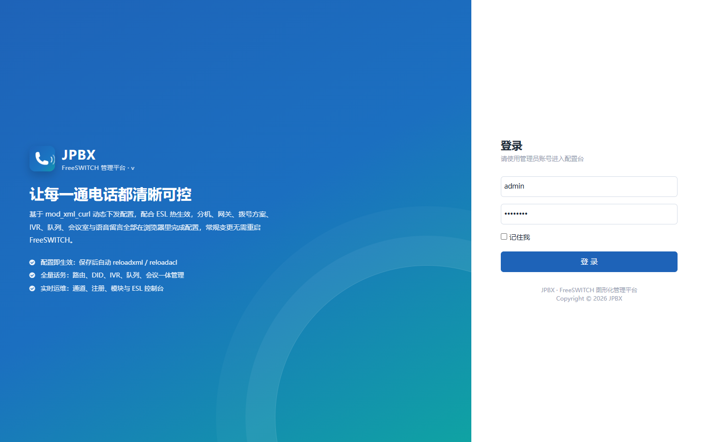

登录后进入主界面：顶栏左侧是系统标识与「软电话」入口，右侧是当前用户与退出；左侧为 PBX 管理分组导航，右侧为内容区，默认打开首页概览（注册数、账户数、网关数、最近通话、ESL 状态）：

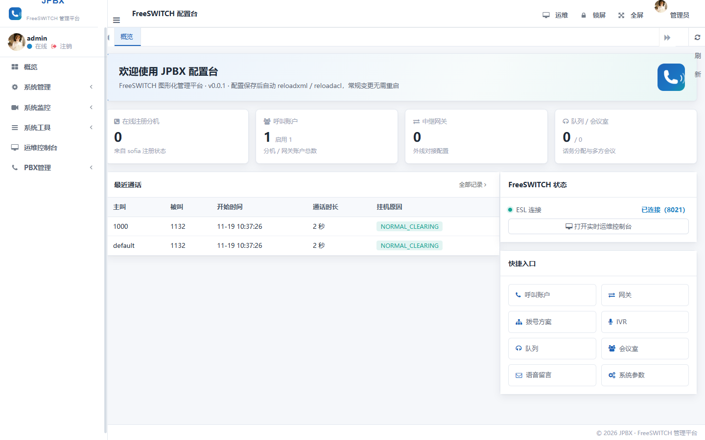

### 2.2 菜单分组与层级导航

PBX 管理固定为 5 个分组，点击分组标题展开/收起，展开后点击叶子菜单进入对应页面：

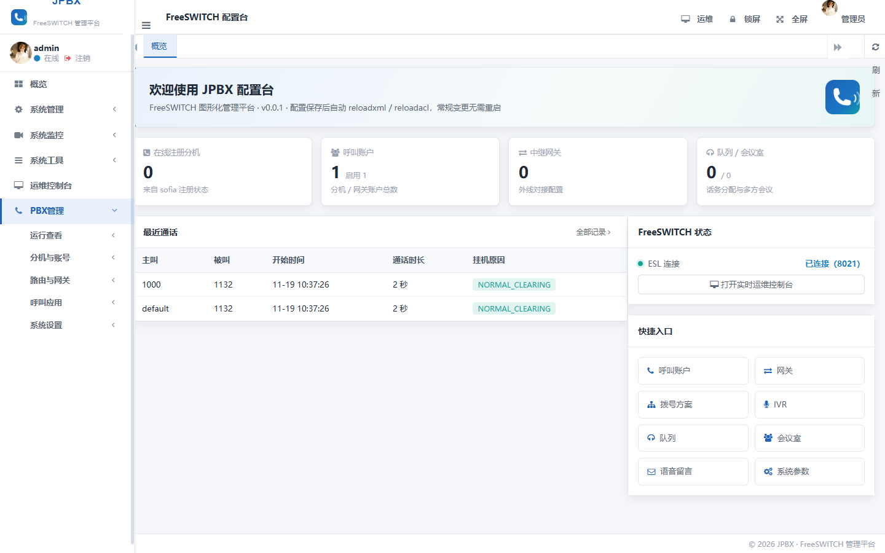

「运行查看」分组展开后可见 6 个只读页面（概览、实时运维、通话记录、录音管理、FS日志、呼叫流程看板）：

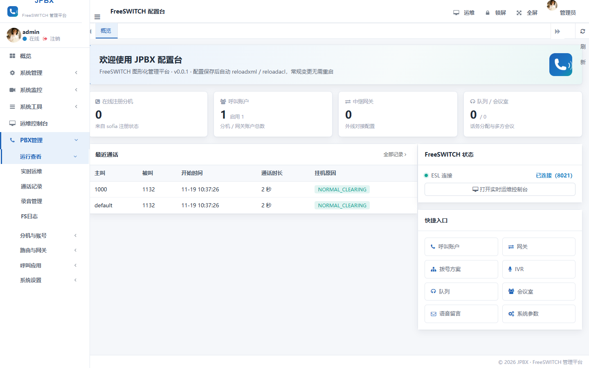

点击叶子菜单后页面在右侧内容区打开，侧边栏保持展开，便于连续切换模块：

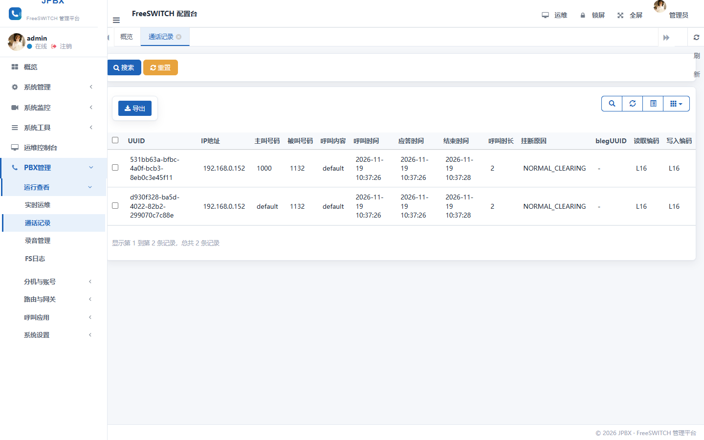

侧边栏为「分组 → 叶子」两级结构，当前页面用高亮底色 + 左侧色条标识，鼠标悬停显示浅色反馈：

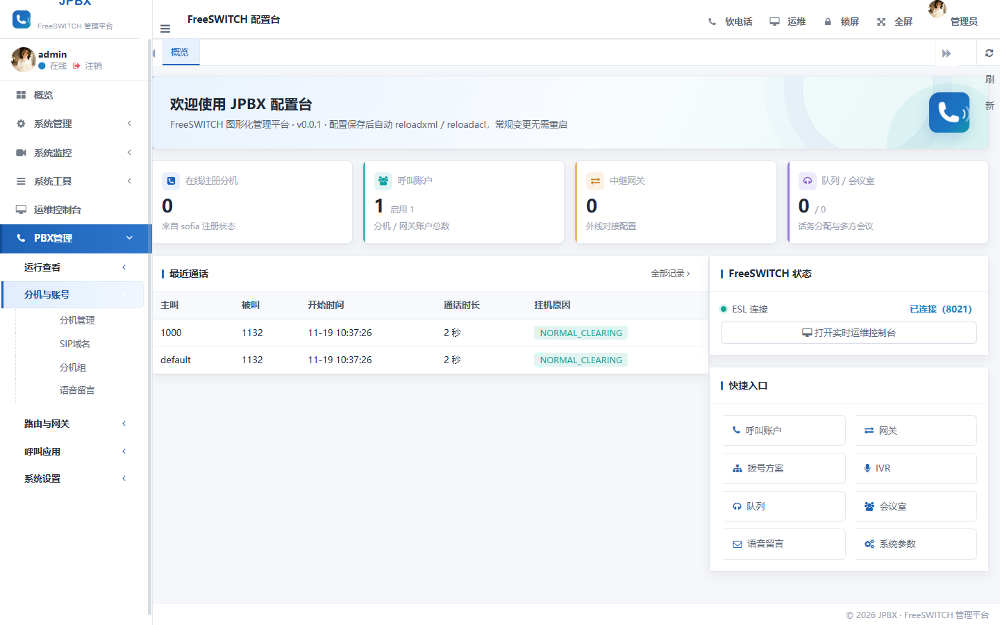

进入任意叶子页面后，所属分组自动展开并保持当前叶子高亮，便于快速确认所处模块：

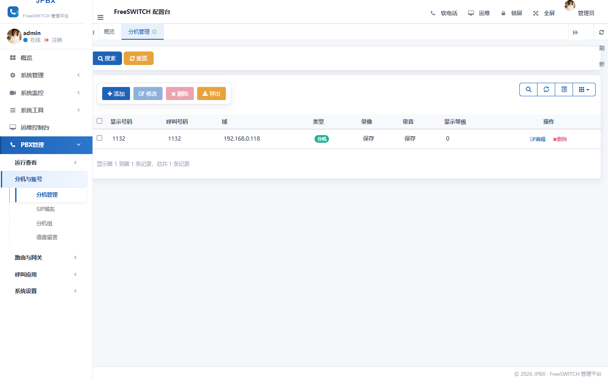

> 顶栏「软电话」是全局悬浮挂件，任何页面都能打开，且不影响当前操作，详见 7.7。

---

## 3. 分机与账号

### 3.1 呼叫账户（分机）

**功能**：维护 SIP 分机账号。保存后写入 `t_pbx_user`，xml_curl 的 directory 段只返回 `type=0 且 enabled=1` 的账号；本地互拨 extension 也只使用这些号码。

**入口**：分机与账号 → 分机管理 → 添加 / 编辑。

列表页展示号码、显示名称、域、账号类型与状态，右侧「编辑 / 删除」为单条操作，顶部为搜索、添加、修改、删除与导出：

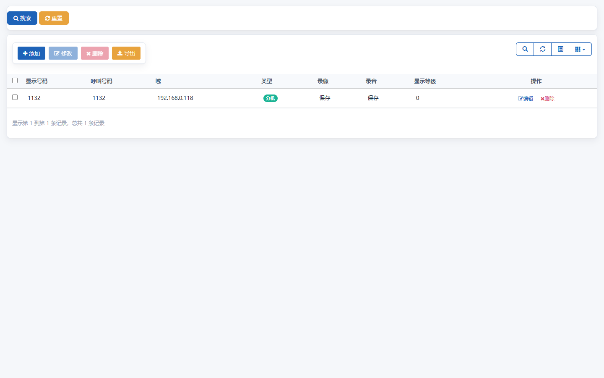

点「添加」弹出「添加呼叫账户管理」对话框，带 `*` 的项为必填：

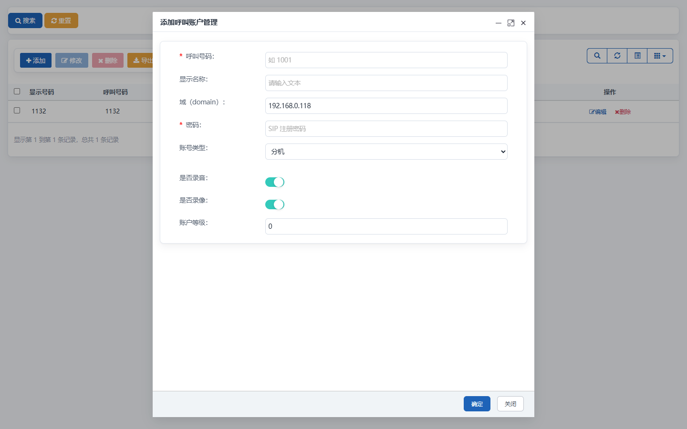

表单字段自上而下为：呼叫号码、显示名称、域（domain）、密码、账号类型、是否录音、是否录像、账户等级；域默认带出系统配置的默认域：


| 字段 | 必填 | 默认 | 取值与含义 | 不同取值的影响 |
| --- | --- | --- | --- | --- |
| 呼叫号码 `number` | 是 | — | 如 `1132`；作为 `<user id>`、`accountcode`、主叫号码 | 改号码等于新建账号；旧号码立即失效，客户端需改用新号注册 |
| 显示名称 `name` | 否 | 空 | 中文名/姓名 | 写入 `effective_caller_id_name` 与 `outbound_caller_id_name`，决定被叫侧来电显示名称 |
| 域 `domain` | 否 | 新增页自动填系统默认域 | SIP 域名或本机 IP | 必须与 SIP 客户端配置的域一致；不一致会鉴权失败或落到错误 domain |
| 密码 `password` | 表单必填 | — | SIP 注册密码 | 写入 `<param name="password">`；修改后在线分机必须重新注册 |
| 账号类型 `type` | 否 | 0 | 字典 `pbx_account_type`：0=分机 | 只有 0 才下发到 directory 与本地拨号；其他值仅作业务标记 |
| 是否录音 `audio` | 否 | 0（使用） | 0=使用，1=停用 | 当前仅为平台标记/导出字段，模板未据此改变录音行为；实际录音由拨号计划 `record_session` 控制 |
| 是否录像 `video` | 否 | 1 | 0/1 | 同上，模板未引用 |
| 账户等级 `level` | 否 | 0 | 数字 | 仅平台展示/权限分层，不进入 FS XML |
| 留言密码 `vmPassword` | 否 | 空 | 语音信箱密码 | 留空时回退到 `password`；用于 `voicemail` 应用登录 |
| 呼叫权限 `toll_allow` | 否 | `domestic,international,local` | 逗号分隔的权限标签 | 写入 channel 变量 `toll_allow`；可配合拨号方案限制长途/国际呼叫 |
| 呼叫组 `callgroup` | 否 | `default` | 组名 | 写入 `callgroup`；本地拨号模板通过 `user_data(... var callgroup)` 读取，可用于寻线组逻辑 |
| dialplan context `userContext` | 否 | `default` | context 名 | 写入 `user_context`；决定该分机发起呼叫后进入的拨号计划上下文 |
| 启用 `enabled` | 否 | 1 | 1/0 | 0 时从 directory 和本地分机列表中消失，无法注册和互拨 |

> **表单与数据表的差异**：页面新增/编辑表单只覆盖上表前 8 项（号码、名称、域、密码、账号类型、录音、录像、等级）。`vmPassword`、`toll_allow`、`callgroup`、`userContext`、`enabled` 保存在 `t_pbx_user` 表中，当前需通过接口或直接维护数据表设置；改完同样要 `reloadxml` 才下发到 FreeSWITCH。

**操作步骤**

1. 添加：填写号码、名称、域、密码，账号类型选「分机」。
2. 保存后页面提示热生效成功（执行 `reloadxml`）。
3. 在 SIP 客户端用 `号码@域` + 密码注册。
4. 在「实时运维 → Sofia 注册」或首页「在线注册分机」确认注册成功。

**验证命令**

```bash
curl -X POST http://localhost:8090/pbx/api/xml \
  -d "token=jpbx-xml-curl-token&section=directory&user=1132&domain=192.168.0.152"
fs_cli -x "sofia status profile internal reg"
# 真实环境输出示例（两台终端注册同一平台的两个分机）：
#   1133@192.168.0.152  SIP.js/0.15.11      WS-NAT  192.168.0.118   （浏览器软电话）
#   1132@192.168.0.152  LinphoneAndroid/4.0.1 UDP    192.168.0.177   （手机 Linphone）
```

---

### 3.2 SIP 域名

**功能**：定义 directory 中的 `<domain>`。domain 是分机归属域，影响注册域、呼叫路由与多租户隔离。

**入口**：分机与账号 → SIP域名。

列表列出所有 SIP 域及其解析/别名开关，分机的 `domain` 必须能在本列表中找到对应记录：

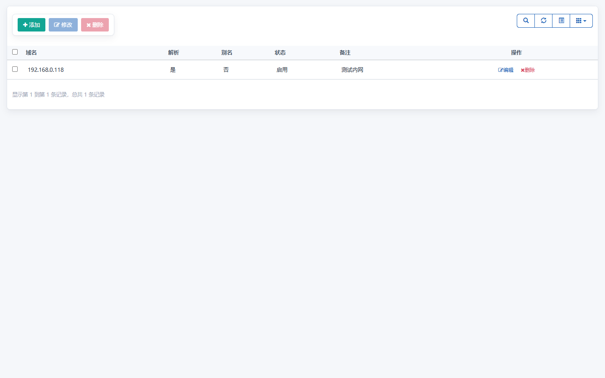

| 字段 | 必填 | 默认 | 含义与影响 |
| --- | --- | --- | --- |
| 域名 `name` | 是 | — | `<domain name="...">`；分机 `domain` 字段应与此一致 |
| 解析 `parse` | 否 | 1 | 生成 `parse="true/false"`；true 时 FS 按域名解析用户，多域场景通常需要 true |
| 别名 `alias` | 否 | 0 | 生成 `alias="true/false"`；true 时该域可作为其他域的别名使用 |
| 启用 `enabled` | 否 | 1 | 0 时不下发该 domain |
| 备注 `remark` | 否 | — | 仅平台说明 |

> 若没有任何启用的 SIP 域名，模板会兜底生成一个 domain：优先取查询参数中的 `domain`，否则取系统参数的 `localIp`。生产环境建议显式配置域名，避免注册域漂移。

**热生效**：`reloadxml`。修改域名后已注册分机通常需要重新注册。

---

### 3.3 分机组

**功能**：把多个分机定义为 `<group>`，供组呼、寻线或 `group` 相关的 dialplan 应用引用。

**入口**：分机与账号 → 分机组 → 添加，选择成员号码。

列表展示组名、域名、成员数与备注，编辑时以多选框维护成员号码：

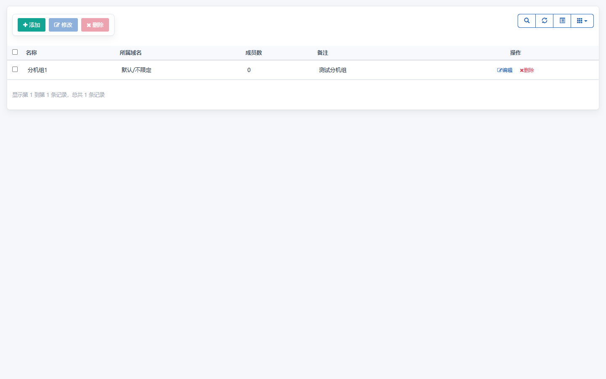

| 字段 | 必填 | 默认 | 含义与影响 |
| --- | --- | --- | --- |
| 分组名称 `name` | 是 | — | `<group name="...">`，拨号计划通过组名引用 |
| 域名 `domain` | 否 | 空 | 限定该组属于哪个 domain；留空则对所有 domain 生效 |
| 成员号码 `memberNumbers` | 否 | 空 | 编译为 `<user id="号码" type="pointer"/>`；必须是已存在的分机号码才有意义 |
| 备注 `remark` | 否 | — | 平台说明 |

**注意**：组内成员是「指针」，不会自动创建分机；若成员号码未在分机管理中启用，组呼时该成员不可用。

**热生效**：`reloadxml`。

---

### 3.4 语音留言

**功能**：该菜单展示已产生的留言记录（谁留言、给哪个分机、时长、是否已读、文件路径），不是留言规则配置入口。

留言列表按时间展示，字段来自 FreeSWITCH 写入的留言记录，平台只读不改：

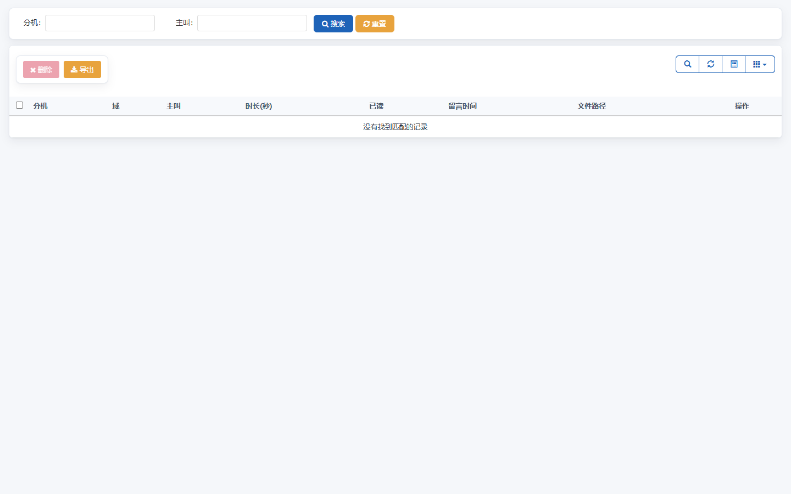

| 字段 | 来源 | 说明 |
| --- | --- | --- |
| 分机 `userNumber` | FS 写入 | 留言归属分机 |
| 域 `domain` | FS 写入 | 所属 SIP 域 |
| 主叫 `caller` | FS 写入 | 留言者号码 |
| 文件路径 `filePath` | FS 写入 | 录音文件在 FS 主机上的路径 |
| 时长 `duration` | FS 写入 | 秒 |
| 已读 `readFlag` | 平台/FS | 0 未读，1 已读 |

**留言功能如何生效**

1. 分机的 `vmPassword` / `password` 决定留言箱密码（见 3.1）。
2. 拨号计划里执行 `voicemail default ${domain_name} <分机号>`，或路由目的地选「语音留言」。
3. `voicemail.conf` 的 `storage-dir`、`max-record-len`、`digit-timeout` 等由「FS 参数配置 → voicemail」控制（见 6.2）。
4. 未接通来电默认进入留言，来自本地分机 extension 模板的末尾动作 `voicemail default ${domain_name} ${dialed_extension}`。

---

## 4. 路由与网关

### 4.1 中继网关

**功能**：定义 `sofia.conf` external profile 下的 `<gateway>`，用于对接运营商或其他 SIP 平台。

**入口**：路由与网关 → 中继网关。

列表展示中继名称、服务器地址、类型/注册、传输方式与启停状态，新增时按「对等中继 / 注册中继」填写不同字段：

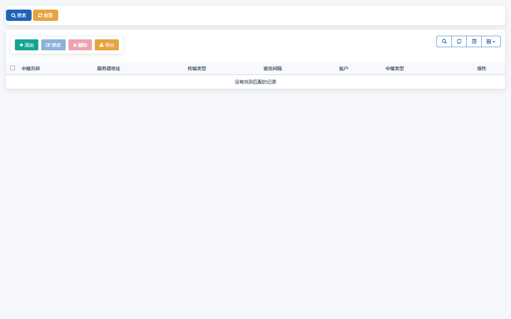

| 字段 | 必填 | 默认 | 取值与含义 | 不同取值的影响 |
| --- | --- | --- | --- | --- |
| 中继名称 `name` | 否 | — | 平台显示名，同时用于路由「网关出局」目的地的匹配 | 改名称后引用旧名的路由将失效 |
| 服务器地址 `realm` | 是（业务上） | — | 对端 SIP 域名/IP:端口 | 写错会注册失败或呼叫无响应 |
| 中继类型 `type` | 否 | 0 | 0=对等中继（不注册），1=注册中继 | 0 时不输出 username/password，仅按 realm 转发；1 时向对端注册 |
| 是否注册 `register` | 否 | 随 type 自动：0→0，1→1 | 生成 `<param name="register">` | 与 type 保持一致即可，通常不需要单独改 |
| 传输类型 `transport` | 否 | `udp` | 字典 `pbx_gateway_translate_type`：udp / tcp / tls | 对端要求 TCP/TLS 时必须改，否则注册被拒 |
| 账户 `username` | 注册时必填 | — | 对端分配的 SIP 账号 | 仅注册中继有效 |
| 密码 `password` | 注册时必填 | — | 对端 SIP 密码 | 仅注册中继有效 |
| 注册间隔 `retrySeconds` | 否 | 30 秒 | `<param name="retry-seconds">` | 越小重注册越频繁，网络抖动时恢复快但增加信令 |
| Sofia profile `profile` | 否 | `external` | 网关所属 profile | 一般保持 external；特殊场景才改 |
| 代理 `proxy` / `fromUser` / `fromDomain` / `expireSeconds` | 否 | 空 / 空 / 空 / 600 | 高级 SIP 头字段与注册过期时间 | 运营商有特殊要求时填写，普通对接留空 |
| 启用 `enabled` | 否 | 1 | 0 时不下发 gateway | 停用后所有引用它的出局路由都会失败 |

**热生效**：`reloadxml` + `sofia profile external killgw <网关ID>` + `rescan`。

**验证**

```bash
fs_cli -x "sofia status gateway <网关ID>"
fs_cli -x "sofia status profile external reg"
```

---

### 4.2 路由管理

**功能**：路由描述「什么号码进来 → 做哪些号码变换 → 最终到哪里去」。平台把路由编译成 `dialplan.xml.vm` 中的 `<extension name="route_...">`，因此它是拨号计划的一部分。

**入口**：路由与网关 → 路由管理。

路由列表的列头就是排查顺序：路由名称 → 匹配前缀 / DID → 路由类型 / 呼入模式 → 中继名称 → 主叫与被叫变换位数 → 目的地。下图是未配置路由时的空列表（提示「没有找到匹配的记录」）：

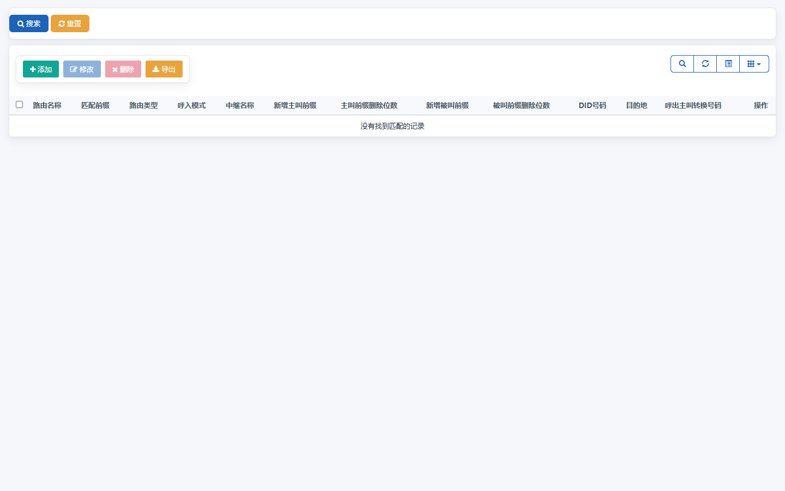

#### 4.2.1 基础字段

| 字段 | 默认 | 含义与影响 |
| --- | --- | --- |
| 路由名称 `name` | — | 生成 extension 名 `route_<名称>`；仅平台标识，重复名称不推荐 |
| 路由类型 `type` | 1 | 字典 `pbx_route_type`：0=内部分机，1=呼出（走中继），2=呼入（中继接入）。保存时自动补 context：2→public，其他→default |
| 匹配前缀 `reg` | 空 | 默认 Matching 表达式，直接写正则；呼入模式优先用 DID（见下） |
| 呼入模式 `inboundModel` | — | 1=普通呼入（按被叫号码），2=DID 呼入（按 DID 号码） |
| DID号码 `did` | 空 | 支持 X/N/Z 通配，编译为正则；type=2 且 did 非空时**优先于 reg** |
| 被叫检测 `calleeCheck` | 空 | 业务字段，当前编译器未直接使用 |
| 转换主叫 `transform` | 空 | 业务字段，当前编译器未直接使用 |
| 目的地类型 `destinationType` | 空 | 决定匹配后执行哪组 action，见下表 |
| 目的地 `destinationValue` | 空 | 分机号 / IVR 名 / 队列名 / 会议室名 / 网关名 / `app:data` |
| 排序 `sortOrder` | 100 | 越小越先匹配；同一 context 下按顺序编译到 XML |
| 启用 `enabled` | 1 | 0 时不下发 |
| 上下文 `context` | 按 type 自动 | 决定出现在 public 还是 default dialplan |

> **重要**：路由表单里的「号码变换明细」列表（`changenums`）会保存到 `t_pbx_change_number`，但当前编译器**尚未把它们转成 dialplan action**。真正生效的号码变换是下面 4 个字段。

#### 4.2.2 号码变换字段（真正生效）

编译顺序固定，先主叫、再被叫、最后目的地：

| 字段 | 编译出的 action | 影响 |
| --- | --- | --- |
| 主叫前缀删除位数 `callerPreRemove` | `set effective_caller_id_number=${caller_id_number:N}` | 从主叫号码左侧删 N 位 |
| 新增主叫前缀 `callerPre` | `set effective_caller_id_number=<前缀>${effective_caller_id_number}` | 在主叫号码前加前缀 |
| 被叫前缀删除位数 `calleePreRemove` | `set outbound_number=${destination_number:N}` | 从被叫号码左侧删 N 位；不填则 `outbound_number=${destination_number}` |
| 新增被叫前缀 `calleePre` | `set outbound_number=<前缀>${outbound_number}` | 在被叫号码前加前缀，出局通常用它拼接中继前缀 |

#### 4.2.3 目的地类型与生成的动作

| 目的地类型 | 值示例 | 生成的 FreeSWITCH 动作 | 效果 |
| --- | --- | --- | --- |
| 分机 `extension` | `1132` | `set hangup_after_bridge=true`、`set continue_on_fail=true`、`bridge user/1132@${domain_name}` | 直接呼分机，失败后继续后续路由 |
| IVR `ivr` | `main_ivr` | `answer`、`sleep 500`、`ivr main_ivr` | 接听后进入 IVR 菜单 |
| 队列 `queue` | `sales` | `answer`、`callcenter sales` | 接听后进入呼叫中心队列 |
| 会议室 `conference` | `3000` | `answer`、`conference 3000@default` | 接听后进入会议室 |
| 语音留言 `voicemail` | `1132` | `voicemail default ${domain_name} 1132` | 直接进留言箱 |
| 网关 `gateway` | `gw_provider` | `bridge sofia/gateway/gw_provider/${outbound_number}` | 从指定中继出局 |
| 自定义应用 `app` | `transfer:9664 XML default` | 按 `应用:数据` 拆分输出 | 高级用法，可调用任意 FS app |
| 未配置（旧规则） | — | type=0 → `bridge user/${destination_number}@${domain_name}`；有网关 → bridge 网关；否则 `hangup NO_ROUTE_DESTINATION` | 兼容旧数据；新配置建议明确选目的地 |

#### 4.2.4 匹配表达式编译规则

```
if (type == 2 && did 非空)  → numberRegex(did)   // X/N/Z 转正则并补 ^ $
else if (reg 非空)          → reg.trim()
else                        → "^$"              // 防误吃掉所有呼叫
```

**热生效**：`reloadxml`。

**验证**

```bash
curl -X POST http://localhost:8090/pbx/api/xml \
  -d "token=jpbx-xml-curl-token&section=dialplan&Caller-Context=public"
# 重点看 <extension name="route_xxx"> 的 expression 和 action 顺序
```

---

### 4.3 拨号方案

**功能**：自定义 `<extension>`，用更灵活的 condition + action 链处理呼叫。适用于路由无法覆盖的场景（如按时段、按主叫、执行播放提示后 transfer）。

**入口**：路由与网关 → 拨号方案。

列表只维护 extension 主体（名称、上下文、条件、排序、状态），动作明细按本节后文通过数据表或接口维护：

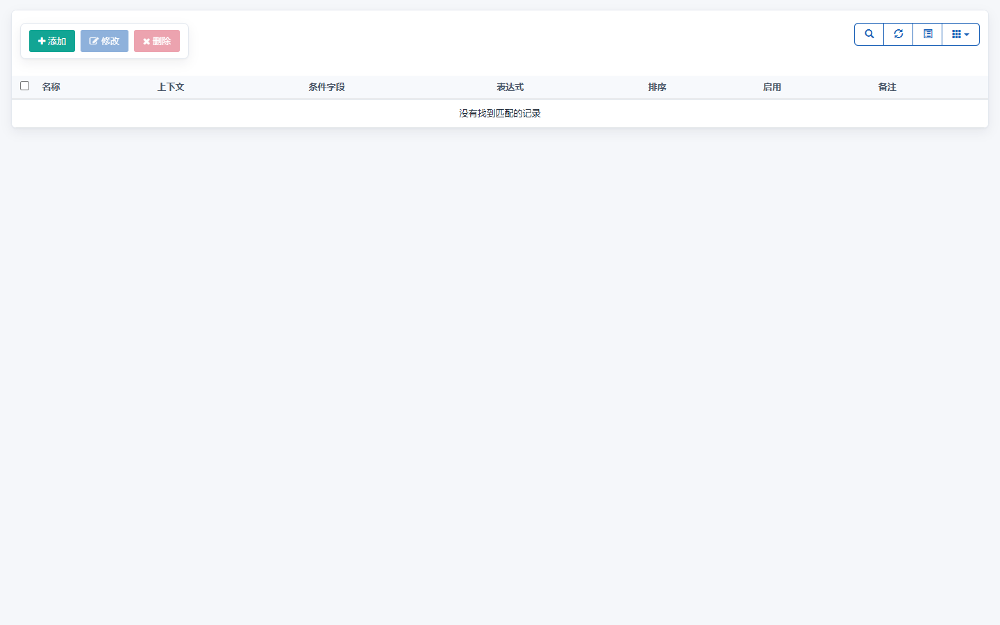

| 字段 | 必填 | 默认 | 含义与影响 |
| --- | --- | --- | --- |
| 名称 `name` | 是 | — | `<extension name="...">`；应与业务语义对应 |
| 上下文 `context` | 是 | `default` | 决定进入 public/default/features 哪套 dialplan |
| 条件字段 `conditionField` | 否 | `destination_number` | 可填 `caller_id_number`、`user_context` 等 FS 变量 |
| 匹配表达式 `conditionExpr` | 是 | — | 正则；只有匹配才执行下面的 action |
| 继续标志 `continueFlag` | 否 | 0 | 1 时 extension 加 `continue="true"`，匹配后继续向下匹配其他 extension |
| 排序 `sortOrder` | 否 | 100 | 越小越先 |
| 启用 `enabled` | 否 | 1 | 0 时不下发 |
| 备注 `remark` | 否 | — | 平台说明 |

**动作（actions）怎么配？**

当前页面只维护 extension 主体，**动作明细没有独立前端界面**，通过以下两种方式维护：

1. 数据库表 `t_pbx_dialplan_action`：

```sql
INSERT INTO t_pbx_dialplan_action
  (id, dialplan_id, application, data, inline_flag, sort_order)
VALUES
  ('dp_a1', '<方案ID>', 'answer',   NULL, 0, 10),
  ('dp_a2', '<方案ID>', 'playback', 'ivr/ivr-welcome.wav', 0, 20),
  ('dp_a3', '<方案ID>', 'hangup',   NULL, 0, 30);
```

2. 通过后端 API 保存（与路由 `changenums` 类似的 JSON 提交方式）。

`application` 是 FreeSWITCH 应用名，`data` 是参数；`inline_flag=1` 表示 `inline="true"`（在该阶段立即执行，不产生新的 channel）；`sort_order` 决定动作顺序。

**常用动作速查**

| application | data 示例 | 作用 |
| --- | --- | --- |
| `answer` | 空 | 接听 |
| `sleep` | `1000` | 等待毫秒 |
| `playback` | `ivr/ivr-welcome.wav` | 播放音频 |
| `set` | `call_timeout=30` | 设置 channel 变量 |
| `bridge` | `user/1132@${domain_name}` | 桥接另一路 |
| `transfer` | `9664 XML default` | 转移到另一 context/extension |
| `ivr` | `main_ivr` | 进入 IVR |
| `callcenter` | `sales` | 进入队列 |
| `conference` | `3000@default` | 进入会议 |
| `voicemail` | `default ${domain_name} 1132` | 进留言箱 |
| `hangup` | `NO_ROUTE_DESTINATION` | 挂断并给出原因 |

**热生效**：`reloadxml`。

---

### 4.4 ACL 访问控制

**功能**：生成 `acl.conf` 的 `<list>`，用于限制哪些 IP 可以向 FreeSWITCH 发起 SIP 请求。ACL 节点在「呼叫流程看板」中也会参与号码/IP 路径模拟。

**入口**：路由与网关 → ACL。

列表展示 ACL 名称、默认策略与网段数量；创建后还需在 FS 参数里引用才真正生效（见本节末尾）：

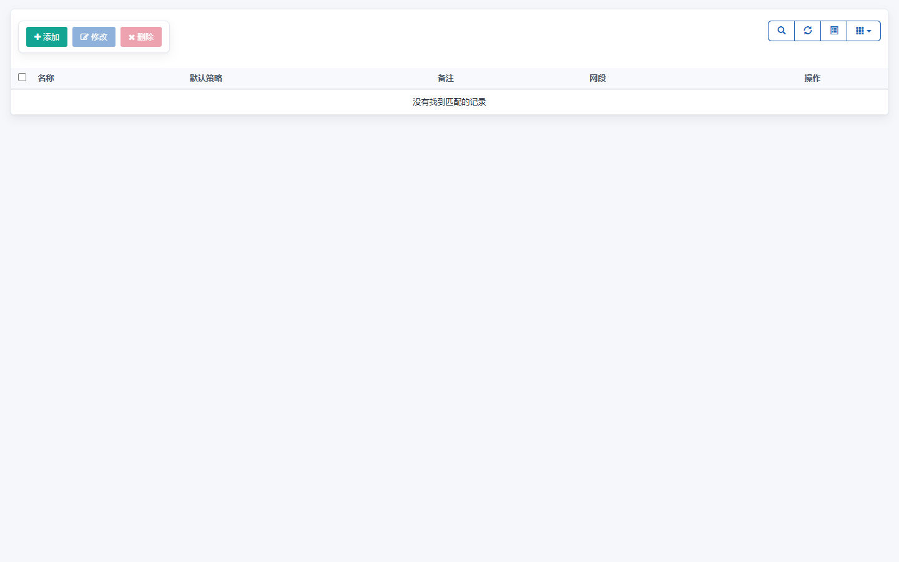

| 字段 | 必填 | 默认 | 含义与影响 |
| --- | --- | --- | --- |
| 名称 `name` | 是 | — | `<list name="...">`；被 sofia profile 的 `apply-inbound-acl` 引用 |
| 默认策略 `defaultType` | 否 | `deny` | `deny`=不在名单内一律拒绝；`allow`=不在名单内放行。**生产建议 deny** |
| 网段 `cidrs` | 否 | 空 | 每行一条 `allow <CIDR>` 或 `deny <CIDR>`；省略前缀默认 allow |

**节点字段**（存 `t_pbx_acl_node`）

| 字段 | 含义 |
| --- | --- |
| `cidr` | IPv4 CIDR，如 `192.168.0.0/16`、`0.0.0.0/0` |
| `nodeType` | `allow` / `deny` |
| `domain` | 可选域名限定，当前模板原样输出 |
| `sortOrder` | 顺序，**自上而下首条命中即结束** |

**系统内置 list**：模板固定输出一个名为 `lan` 的 list，默认 `allow`，节点为 `deny 0.0.0.0/0` 后跟几个私网段 allow。它不受页面管理影响。

**如何真正启用 ACL**

仅创建 list 不会自动拦截，还需要在「FS 参数配置 → sofia.conf/internal 或 external」把 `apply-inbound-acl` 设为该 list 名称（如 `trusted`），保存后执行 `profile restart`。

**示例**

```
名称：trusted
默认策略：deny
网段：
allow 192.168.0.0/16
allow 127.0.0.1/32
deny  0.0.0.0/0
```

效果：只有办公网和本机可向 internal profile 注册/发起呼叫；其他 IP 被拒绝。

**热生效**：`reloadxml` + `reloadacl`。

---

## 5. 呼叫应用

### 5.1 IVR 菜单

**功能**：生成 `ivr.conf` 的 `<menu>`，实现语音导航按键流程。进入方式：路由目的地选 IVR，或拨号方案中拨 `ivr_<名称>`。

**入口**：呼叫应用 → IVR菜单。

列表展示菜单名、欢迎音、超时/失败次数与状态；按键条目不在列表页，需按本节后文维护：

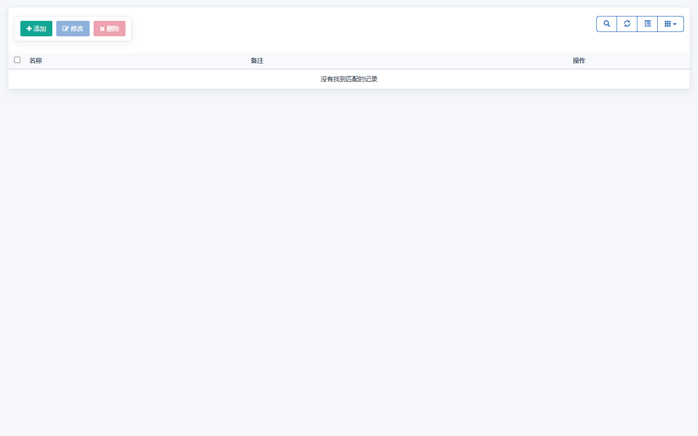

| 字段 | 必填 | 默认 | 含义与影响 |
| --- | --- | --- | --- |
| 名称 `name` | 是 | — | `<menu name>`；路由/拨号计划引用它，改名称会断引用 |
| 长欢迎音 `greetLong` | 否 | `ivr/ivr-welcome.wav` | 首次进入播放；路径相对 FS sounds 目录 |
| 短欢迎音 `greetShort` | 否 | 同长欢迎音 | 循环/回退时播放，可设简短提示 |
| 超时 `timeout` | 否 | 10000 ms | 等待首位按键时间；超时次数达 `maxTimeouts` 后走退出流程 |
| 最大失败 `maxFailures` | 否 | 3 | 输入无匹配按键的最大次数，超过后按失败处理 |
| 启用 `enabled` | 否 | 1 | 0 时不下发 menu |
| 备注 `remark` | 否 | — | 平台说明 |

**隐藏默认值**（由 `IvrDefaults` 补齐，页面未暴露）：

| 字段 | 默认值 | 影响 |
| --- | --- | --- |
| `invalidSound` | `ivr/ivr-that_was_an_invalid_entry.wav` | 无效按键提示音 |
| `exitSound` | `voicemail/vm-goodbye.wav` | 退出提示音 |
| `maxTimeouts` | 3 | 最大超时次数 |
| `digitLen` | 1 | 每次收集按键位数；设 2 可支持 00-99 菜单 |
| `interDigit` | 2000 ms | 按键间间隔超时 |

**按键条目（entries）怎么配？**

页面目前只提供基础字段，**按键条目没有独立 UI**，通过 `t_pbx_ivr_entry` 维护：

| 字段 | 含义 |
| --- | --- |
| `ivrId` | 所属 IVR 的 ID |
| `digits` | 按键值，如 `1`、`2`、`0`、`*` |
| `action` | FreeSWITCH ivr menu entry action，常见：`extension`、`voicemail`、`transfer`、`menu`、`playback`、`hangup`、`exec`、`set`、`break` |
| `param` | 动作参数，含义随 action 变化：`extension`→分机号；`transfer`→`目标 XML context`；`menu`→目标菜单名；`voicemail`→分机号 |
| `sortOrder` | 顺序 |

示例：

```sql
INSERT INTO t_pbx_ivr_entry(id, ivr_id, digits, action, param, sort_order) VALUES
('ivr_e1','<IVR_ID>','1','extension','1132',10),
('ivr_e2','<IVR_ID>','2','conference','3000',20),
('ivr_e3','<IVR_ID>','0','hangup','',30);
```

> 配置完成后可在「呼叫流程看板」点击 IVR 目的地节点查看按键分支（只读展示）。

**热生效**：`reloadxml`。

---

### 5.2 呼叫队列

**功能**：生成 `callcenter.conf` 的 `<queue>`，与坐席、Tier 配合实现来电排队与分配。

**入口**：呼叫应用 → 呼叫队列。

列表展示队列名、策略与等待音乐；坐席与队列的绑定关系不在本页维护（见 5.4）：

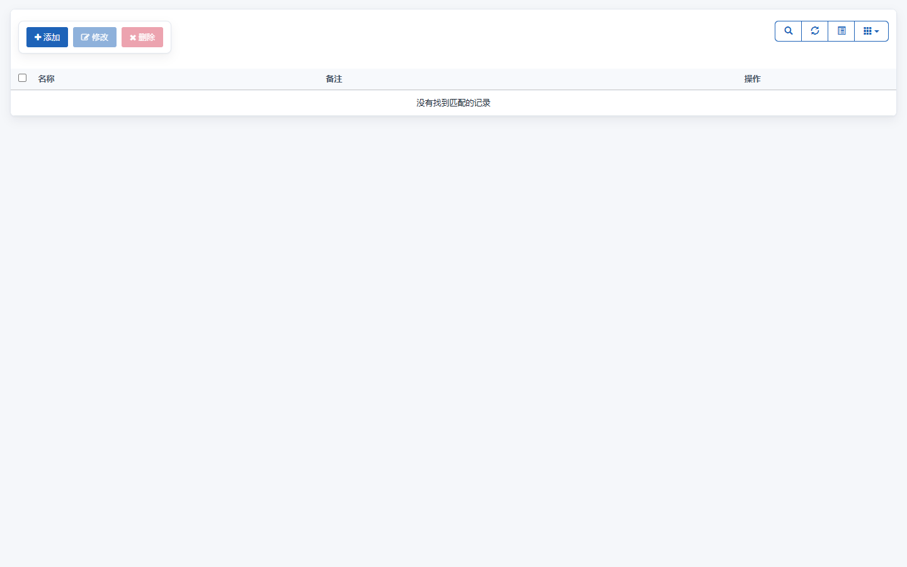

| 字段 | 必填 | 默认 | 含义与影响 |
| --- | --- | --- | --- |
| 队列名 `name` | 是 | — | `<queue name>`；路由目的地填此名称；改名称会断引用 |
| 策略 `strategy` | 否 | `longest-idle-agent` | 决定来电分配给哪个坐席，见下表 |
| 等待音乐 `mohSound` | 否 | `$${hold_music}` | 排队时播放的音源 |
| 最大等待 `maxWaitTime` | 否 | 0 | 秒；0=不限。超时后按队列超时策略处理 |
| 启用 `enabled` | 否 | 1 | 0 时不下发 |

**策略取值及影响**

| strategy | 分配方式 | 适用场景 |
| --- | --- | --- |
| `longest-idle-agent` | 空闲时间最长的坐席 | 均衡工作量，最常用 |
| `round-robin` | 轮询 | 坐席能力相近 |
| `top-down` | 按 tier 顺序自上而下 | 有明确优先级 |
| `agent-with-least-talk-time` | 累计通话时长最少 | 追求通话时长均衡 |
| `agent-with-fewest-calls` | 接听次数最少 | 追求次数均衡 |
| `sequentially-by-agent-order` | 按坐席顺序 | 固定接听顺序 |
| `random` | 随机 | 简单随机分配 |
| `ring-all` | 所有可用坐席同时振铃 | 小团队快速接听 |

**模板中其他字段**（数据库有，页面高级项）：`timeBaseScore`（默认 system）、`maxWaitTimeWithNoAgent`（0）、`tierRulesApply`（0→false）、`discardAbandonedAfter`（60 秒）、`abandonedResumeAllowed`（0→false）。

**热生效**：`reloadxml` + `callcenter_config queue unload/load <队列名>`。

**验证**

```bash
fs_cli -x "callcenter_config queue list"
fs_cli -x "callcenter_config queue show <队列名>"
```

---

### 5.3 坐席管理

**功能**：生成 `callcenter.conf` 的 `<agent>`，定义可接听队列来电的坐席。

**入口**：呼叫应用 → 坐席管理。

列表展示坐席名、Contact、类型与状态，状态为 `Logged Out` 的坐席不会接听任何队列来电：

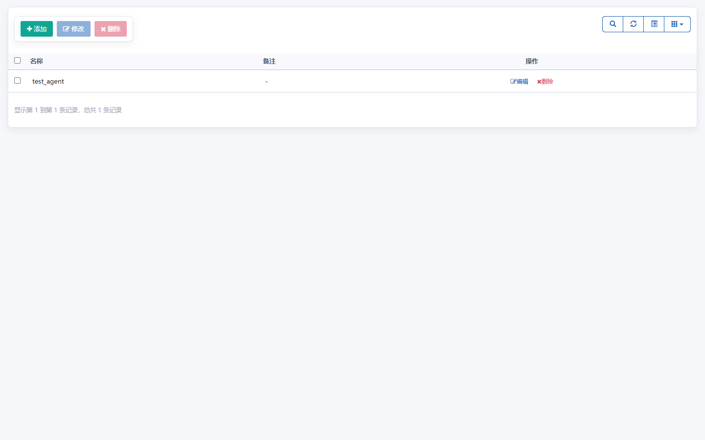

| 字段 | 必填 | 默认 | 含义与影响 |
| --- | --- | --- | --- |
| 坐席名 `name` | 是 | — | `<agent name>`；Tier 通过 agentName 引用它 |
| Contact `contact` | 是 | — | 振铃目标，格式是 FS dial string；示例 `user/1132`、`user/1133`。写错则坐席无法接听 |
| 类型 `type` | 否 | `callback` | `callback`=由 callcenter 主动发起；`uuid-standby`=已在通话中的坐席待命 |
| 状态 `status` | 否 | `Logged Out` | `Logged Out` 不接听；`Available` 可接听；`Available (On Demand)` 按需上线；`On Break` 休息中不接听 |
| 启用 `enabled` | 否 | 1 | 0 时不下发 |
| 备注 `remark` | 否 | — | 平台说明 |

**模板默认值**：`maxNoAnswer=3`（无应答次数）、`wrapUpTime=10`（通话后整理秒数）、`rejectDelayTime=10`、`busyDelayTime=60`。这些字段数据库中有，高级页面可维护。

**热生效**：`reloadxml` + `reload mod_callcenter`（或指定队列时 unload/load）。

> 已知行为：删除坐席后，FreeSWITCH 运行时对象可能仍保留，需在 ESL 执行 `callcenter_config agent del <坐席名>` 或 `reload mod_callcenter` 彻底清理。

---

### 5.4 Tier 分机绑定

**功能**：把坐席绑定到队列，并定义优先级。生成 `<tier agent="..." queue="..." level="..." position="..."/>`。

**入口**：当前版本**没有独立页面**。后端仅提供 `/pbx/tier` 的 `list / add / remove` 三个 JSON 接口（权限 `pbx:queue:edit`），配置写入 `t_pbx_tier` 后随 `callcenter.xml` 下发。因此本页无法截图，绑定关系通过接口或直接维护数据表完成：

```http
POST /pbx/tier/add
queueName=sales&agentName=agent1001&level=1&position=1
```

> 想看绑定结果是否生效，用「运行查看 → 呼叫流程看板」，队列节点会显示 `坐席名(L级别)`，见 7.6。

| 字段 | 必填 | 默认 | 含义与影响 |
| --- | --- | --- | --- |
| 队列名 `queueName` | 是 | — | 必须存在于已启用的队列 |
| 坐席名 `agentName` | 是 | — | 必须存在于已启用的坐席 |
| 级别 `level` | 否 | 1 | **数值越小优先级越高**；1 级坐席接完才轮到 2 级 |
| 位置 `position` | 否 | 1 | 同级别内顺序 |

**热生效**：`reloadxml` + 队列 unload/load 或 `reload mod_callcenter`。

---

### 5.5 会议室

**功能**：生成 `conference.xml.vm` 的 `<advertise><room>`（房间清单）和拨号计划里的 `conf_<名称>` extension，实现拨号进会议。

**入口**：呼叫应用 → 会议室。

列表展示会议室号、Profile、PIN 与最大人数；会议室号同时决定拨号规则 `conf_<号码>`：


| 字段 | 必填 | 默认 | 含义与影响 |
| --- | --- | --- | --- |
| 会议室号 `name` | 是 | — | 拨此号码进入；生成 `^<name>$` 的 extension；改名称后旧号码失效 |
| Profile `profile` | 否 | `default` | 会议参数组名，对应 `t_pbx_conference_profile` 或默认 profile |
| PIN `pin` | 否 | 空 | 非空时拨号计划加 `flags{mintwo}` 并附加 PIN，入会需输入密码 |
| 最大人数 `maxMembers` | 否 | 50 | 平台业务字段；当前模板未据此强制限制 |
| 启用 `enabled` | 否 | 1 | 0 时不下发房间与 extension |

**入会方式**

- 直接拨会议室号（如 `3000`）；
- 路由目的地选「会议室」，值填会议室号。

**会议内按键**（默认 `caller-controls` 组）：`0` 静音、`*` 聋静、 `9/8/7` 调能量、`3/2/1` 调讲话音量、`6/5/4` 调收听音量、`#` 挂断。

**Conference Profile**（高级，表 `t_pbx_conference_profile`）

| 字段 | 默认 | 含义 |
| --- | --- | --- |
| `name` | — | profile 名称 |
| `rate` | 8000 | 采样率；16000/32000/48000 可提升音质但占带宽 |
| `interval` | 20 | 打包间隔 ms |
| `energyLevel` | 300 | 语音活动检测阈值，越大越不易被判为讲话 |
| `callerControls` | default | 按键控制组名 |

**热生效**：`reloadxml`。

---

## 6. 系统设置

### 6.1 系统参数

**功能**：全局 IP、端口、编解码、录音路径、CDR 连接串等。入口：系统设置 → 系统参数 → 编辑配置。

系统参数只有一条记录，列表先展示最常看的几列（本机IP、外网IP、注册/中继端口、RTP 区间、录音路径），点「编辑配置」进入完整表单，点「热生效」等价于 reloadxml + SIP profile 重启：

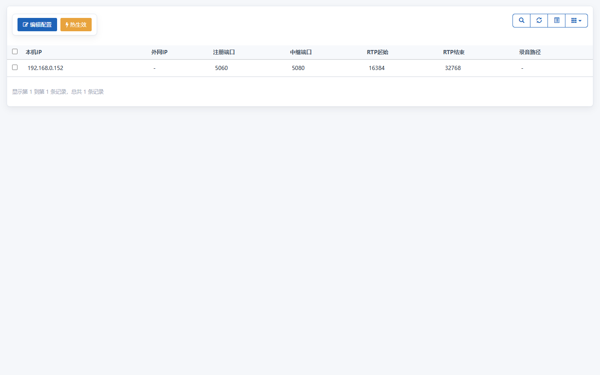

| 字段 | 默认 | 含义与影响 |
| --- | --- | --- |
| 本机IP `localIp` | — | 未配置 SIP 域名时作为兜底 domain；部分模板用作 SIP/RTP 绑定 IP 的回退值 |
| 外网IP `remoteIp` | — | NAT 场景对外通告地址参考 |
| 中继端口 `externalPort` | 5080（FS 常见默认） | 写入 `sofia.conf external` 的 `sip-port`（当 FS 参数未覆盖时） |
| 注册端口 `internalPort` | 5060 | 写入 internal profile（当 FS 参数未覆盖时） |
| 起始/结束 RTP 端口 `startRtpPort`/`endRtpPort` | 16384/32768 | 媒体端口池范围；并发每路约需 2 个端口 |
| WS/WSS 端口 `wsPort`/`wssPort` | 5066/7443 | 浏览器软电话连接端口；需与 FS profile 的 `ws-binding`/`wss-binding` 一致 |
| 音频编码 `audioCode` | — | 写入 sofia 的 `inbound/outbound-codec-prefs`（当 FS 参数未覆盖时） |
| 视频编码 `videoCode` | — | 同上，拼在音频编码后 |
| 分辨率 `frameRate` / 码率 `bitRate` | — | 视频参数，供模板/业务参考 |
| 是否启动ICE `iceStart` | false | WebRTC/NAT 穿透；开启需同时配置 STUN |
| STUN地址 `stunAddress` | — | 如 `stun:stun.l.google.com:19302` |
| 是否录音/录像 `audioRecord`/`videoRecord` | true/false | 平台标记；实际录音由拨号计划的 `record_session` 动作决定 |
| 音频/视频存储地址 `audioRecordPath`/`videoRecordPath` | — | 录音与留言文件根目录，FS 进程必须有写权限；拨号计划的 `record_path` 与 voicemail 的 `storage-dir` 会用到 |
| 声音文件地址 `soundFilePath` | — | 自定义语音文件路径 |
| FS 安装路径 `freeswitchPath` | — | 日志/录音页面读取文件用 |
| FS 日志路径 `freeswitchLogPath` | — | 「FS日志」页面读取文件用；留空会提示“未配置” |
| CDR 连接串 `cdrDbInfo` | — | **关键**：`cdr_pg_csv.conf` 的 `db-info`。格式 `host=127.0.0.1 port=5432 dbname=youpbx user=postgres password=xxx connect_timeout=10`；配错会导致 CDR 写入 spool 文件而不是 `cdr` 表 |

**热生效**：`reloadxml` + `sofia profile internal/external restart`（含 IPv6 profile）。**在线注册会掉线，需客户端重新注册**。

**验证**

```bash
curl -X POST http://localhost:8090/pbx/api/xml \
  -d "token=jpbx-xml-curl-token&section=configuration&key_value=cdr_pg_csv.conf"
psql -U postgres -d youpbx -c "select count(*) from cdr;"
```

---

### 6.2 FS 参数配置

**功能**：按配置段维护具体参数名/值，xml_curl 渲染到对应 XML。入口：系统设置 → FS参数配置（左侧分组导航 + 右侧参数表）。

左侧「配置段」固定为 8 组：核心 switch.conf、Sofia Internal（分机）、Sofia External（中继）、ACL 访问控制、CDR PostgreSQL、语音留言、会议室 Profile、ESL 对接说明。每个参数同时显示中文名、真实参数名、默认值、示例与生效方式，底部为「保存并热生效 / 仅保存 / 校验」：

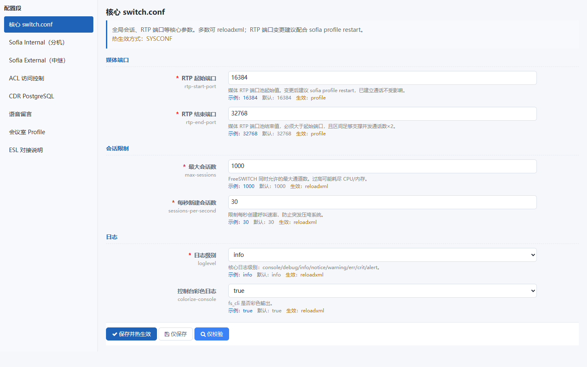

**生效方式（`applyHint`）**

| 提示 | 实际动作 |
| --- | --- |
| `profile` | reloadxml + `sofia profile <internal/external> restart` |
| `reloadxml` | reloadxml |
| `reloadacl` | reloadxml + reloadacl |
| `reload_module` | reloadxml + `reload mod_cdr_pg_csv` 等模块 |
| `docs` | 仅说明，不在平台写入 FS 文件 |

#### switch.conf（全局）

| 参数 | 默认 | 含义与影响 | 生效 |
| --- | --- | --- | --- |
| `rtp-start-port` / `rtp-end-port` | 16384 / 32768 | 媒体 RTP 端口池；区间需覆盖并发×2 | profile |
| `max-sessions` | 1000 | 最大同时通道数；过高耗 CPU/内存 | reloadxml |
| `sessions-per-second` | 30 | 每秒新建呼叫上限，防突发压垮 | reloadxml |
| `loglevel` | info | console/debug/info/notice/warning/err/crit/alert | reloadxml |
| `colorize-console` | true | fs_cli 彩色输出 | reloadxml |

#### sofia.conf / internal（内部分机）

| 参数 | 默认 | 含义与影响 |
| --- | --- | --- |
| `sip-port` | 5060 | 内部分机注册/呼叫端口；改动后客户端需改端口 |
| `sip-ip` / `rtp-ip` | 空 | 绑定 IP，空则用 `$${local_ip_v4}` |
| `ext-sip-ip` / `ext-rtp-ip` | 空 | NAT 场景对分机通告的公网地址，可填 `stun:...` |
| `context` | default | 入呼进入的 dialplan context |
| `dialplan` | XML | 固定值，使用 mod_dialplan_xml（走 xml_curl） |
| `inbound-codec-prefs` / `outbound-codec-prefs` | PCMU,PCMA,OPUS | 编解码优先级，从左到右。**PCMU 必须在 OPUS 之前**：浏览器（Chrome WebRTC）的 opus 是双声道（stereo=2），手机端（Linphone 等）是单声道（mono=1），FS 对同名 opus 会直通转发，声道不一致时两端都收不到对方（双向无声）；PCMU 优先后两端统一协商 PCMU，彻底规避 |
| `inbound-codec-negotiation` | greedy | `greedy`=按 FS 编解码偏好顺序协商（编解码优先级才生效）；`generous`=按对端 offer 顺序协商。混用 WebRTC 与手机端时**必须 greedy**，否则手机端 offer 里 opus 排第一会绕过 PCMU 优先 |
| `auth-calls` | true | true=仅接受已鉴权分机呼叫；改 false 会有安全风险 |
| `accept-blind-reg` | false | **必须为 false**，否则注册不走 directory，平台分机密码失效 |
| `apply-inbound-acl` | domains | 引用的 ACL list 名，如 `trusted` |
| `manage-presence` | true | 是否处理订阅/状态呈现 |
| `nonce-ttl` | 60 | SIP Digest nonce 有效期秒 |
| `rtp-timeout-sec` | 300 | 无媒体超时秒 |
| `ws-binding` / `wss-binding` | :5066 / :7443 | 浏览器软电话 WS/WSS 监听 |

所有 internal 参数生效方式均为 `profile restart`。

#### sofia.conf / external（外线中继）

| 参数 | 默认 | 含义与影响 |
| --- | --- | --- |
| `sip-port` | 5080 | 外线端口，勿与 internal 冲突 |
| `sip-ip` / `rtp-ip` | 空 | 外线绑定 IP |
| `ext-sip-ip` / `ext-rtp-ip` | 空 | 对运营商通告的公网地址，NAT 必配 |
| `context` | public | 外线入呼 context |
| `auth-calls` | false | 外线通常 false，靠 ACL/网关鉴权 |
| `accept-blind-reg` | false | 外线建议 false |
| `inbound/outbound-codec-prefs` | PCMU,PCMA | 运营商常用 G.711；需与对端匹配 |
| `apply-inbound-acl` | 空 | 限制哪些运营商 IP 可打入 |
| `rtp-timeout-sec` | 300 | 无媒体超时 |

#### cdr_pg_csv.conf（话单）

| 参数 | 默认 | 含义与影响 |
| --- | --- | --- |
| `db-info` | 空 | libpq 连接串；**留空或密码错会导致 CDR 写入 spool 而非 cdr 表** |
| `db-table` | cdr | 写入表名，需与建表一致 |
| `legs` | a | `a`=只记 A 腿，`ab`/`b`=双腿记录，`b`=只记 B 腿 |
| `spool-format` | csv | 写库失败时本地缓存格式：csv/sql |
| `rotate-on-hup` | true | HUP 时是否轮转 spool |

#### voicemail.conf

| 参数 | 默认 | 含义与影响 |
| --- | --- | --- |
| `file-extension` | wav | wav/mp3/ogg |
| `storage-dir` | 空（回退 `$${storage_dir}`） | 留言文件根目录，FS 需可写 |
| `max-record-len` | 300 | 单条留言最长秒 |
| `digit-timeout` | 10000 | 收号超时 ms |
| `max-login-attempts` | 3 | 密码错误次数上限 |

#### conference.conf

| 参数 | 默认 | 含义与影响 |
| --- | --- | --- |
| `rate` | 8000 | 采样率，越高音质越好但占资源 |
| `interval` | 20 | 打包间隔 ms |
| `energy-level` | 300 | 语音活动检测阈值 |
| `caller-controls` | default | 按键控制组 |
| `comfort-noise` | true | 舒适噪声 |

#### acl.conf / event_socket（说明段）

- `acl.conf`：仅提示到 ACL 菜单维护 CIDR 节点，此处不直接编辑 XML。
- `event_socket`：ESL 的 `listen-ip`/`listen-port`/`password` 说明；需与 `fs.properties` 的 `eslHost`/`eslInBoundPort`/`eslpwd` 一致，修改后需在 FS 执行 `reload mod_event_socket`。

### 6.3 系统用户与菜单权限

**功能**：维护能登录本平台的账号，以及每个账号能看到哪些 PBX 菜单。与 FreeSWITCH 分机账号（3.1）无关：分机用于 SIP 注册，系统用户用于登录管理台。

**入口**：右上角头像 → 系统管理。

| 菜单 | 路径 | 用途 |
| --- | --- | --- |
| 用户管理 | `/system/user` | 新建/停用登录账号，分配部门与角色 |
| 角色管理 | `/system/role` | 定义角色，给角色勾选菜单权限与数据范围 |
| 菜单管理 | `/system/menu` | 维护菜单树（含 PBX 各页面的 `pbx:*:view` 权限标识） |
| 部门管理 | `/system/dept` | 组织机构树，用户归属 |
| 岗位管理 | `/system/post` | 岗位字典，仅业务标记 |
| 字典管理 | `/system/dict` | `pbx_account_type`、`pbx_route_type` 等下拉数据来源 |
| 参数设置 | `/system/config` | 平台运行参数（非 FreeSWITCH 参数） |
| 通知公告 | `/system/notice` | 登录后公告弹窗 |
| 日志管理 | `/monitor/operlog`、`/monitor/logininfor` | 操作日志与登录日志 |

用户管理页左侧是部门树，右侧列表显示登录名称、用户名称、部门、手机、状态与创建时间；「新增 / 修改 / 删除 / 导入 / 导出」在列表上方：

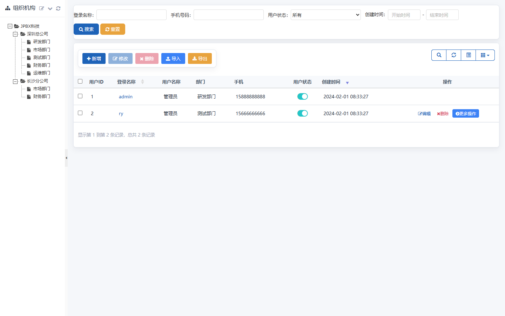

**给账号授权菜单的标准流程**

1. 角色管理 → 新增角色（如「运维」），填角色名称与权限字符。
2. 角色列表 → 「菜单权限」→ 在菜单树中勾选该角色可见的 PBX 页面（如「运行查看 → 通话记录」），保存。
3. 用户管理 → 选中账号 → 「更多操作 → 分配角色」→ 勾选刚建的角色，保存。
4. 该账号重新登录（或刷新页面）后，左侧只显示被授权的分组与叶子菜单；未授权的 URL 直接访问会被 `@RequiresPermissions` 拦截。
5. 需要限制到单条数据（如仅本部门）时，用角色管理的「数据权限」设置数据范围。

> 注意：菜单权限只控制系统用户能看/能改哪些页面，不影响分机注册与呼叫；分机侧的鉴权仍由 directory + ACL 决定（见 3.1、4.4）。

---

## 7. 运行查看类功能

### 7.1 首页概览

登录后默认进入首页，四张卡片给出容量与健康度，右侧「FreeSWITCH 状态」是判断热生效能否成功的先决条件（绿色「已连接 8021」表示 ESL 正常）：

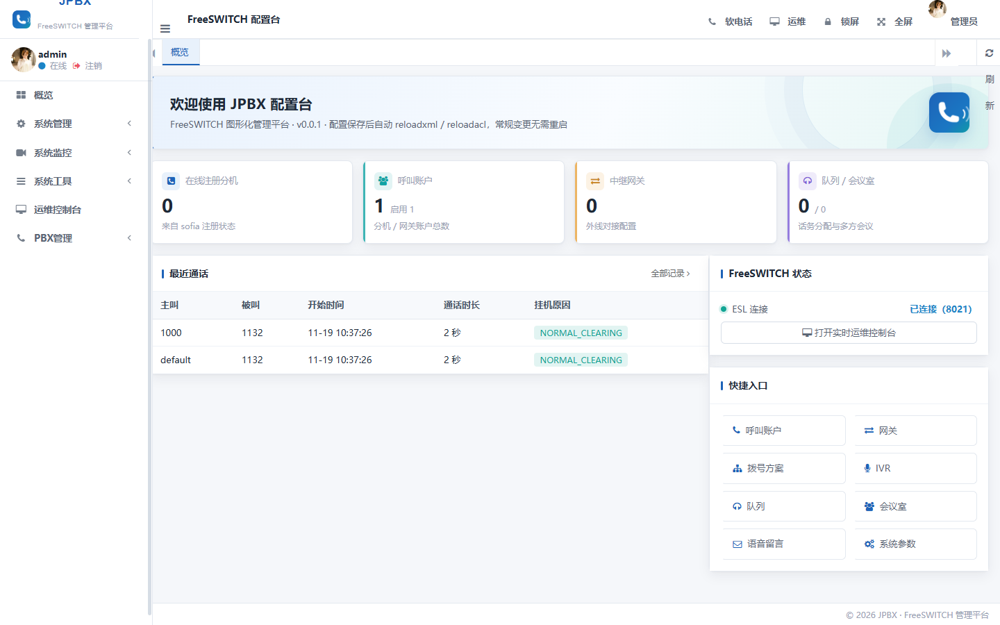

概览区特写：在线注册分机（来自 sofia 注册状态）、呼叫账户（启用数/总数）、中继网关（外线对接数）、队列/会议室（话务分配与多方会议），下方「最近通话」与「快捷入口」可直接跳转：

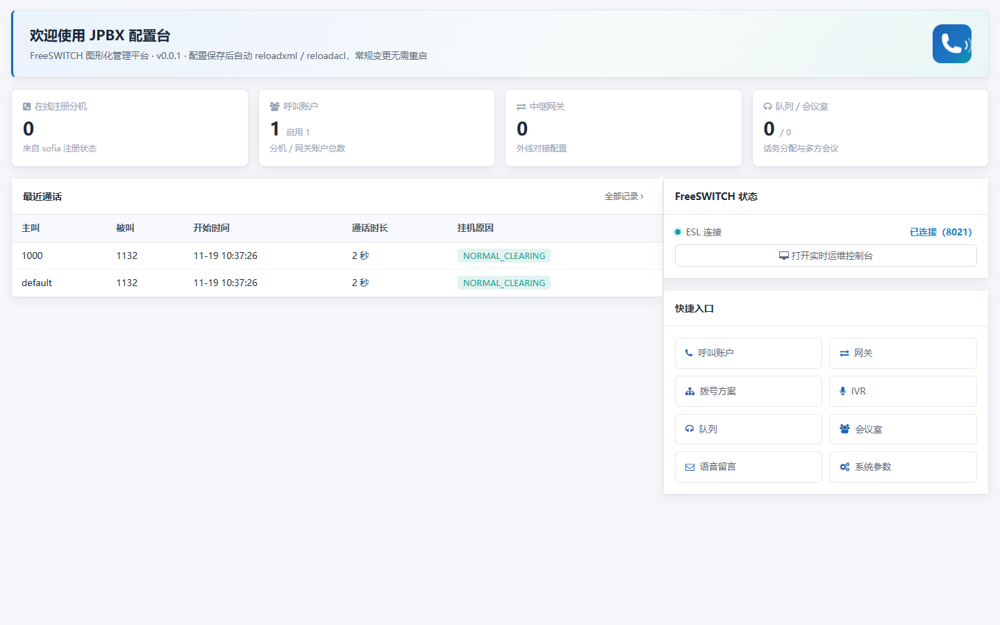

- 「在线注册分机」来自 `show registrations`；显示为 0 不一定是故障，可能没有 SIP 客户端注册。
- 「呼叫账户」显示总数与启用数；「中继网关」显示外线对接数。
- 「最近通话」取 CDR 表最新记录，点击「全部记录」进入通话记录页。
- 「FreeSWITCH 状态」显示 ESL 连接状态（绿色=已连接 8021）；未连接时所有热生效都会失败。

### 7.2 实时运维

页面顶部按钮分别是「刷新通道 / Sofia 状态 / reloadxml / ESL 控制台 / 重启FS服务」，下方表格列出当前存活通道（UUID、主叫、被叫、状态、创建时间），无通话时显示「没有找到匹配的记录」：

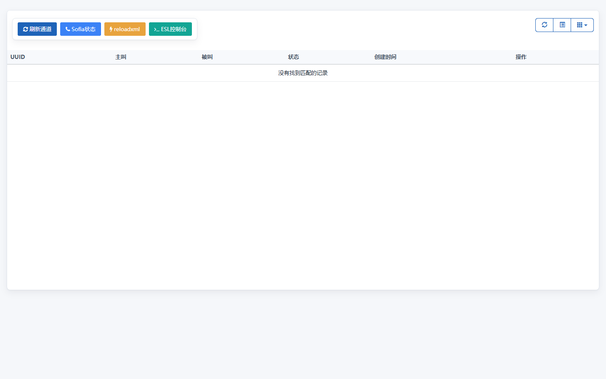

ESL 控制台可执行 FreeSWITCH API，输出以终端风格回显；`fsctl`、`shutdown`、`hupall` 等危险命令被禁用：

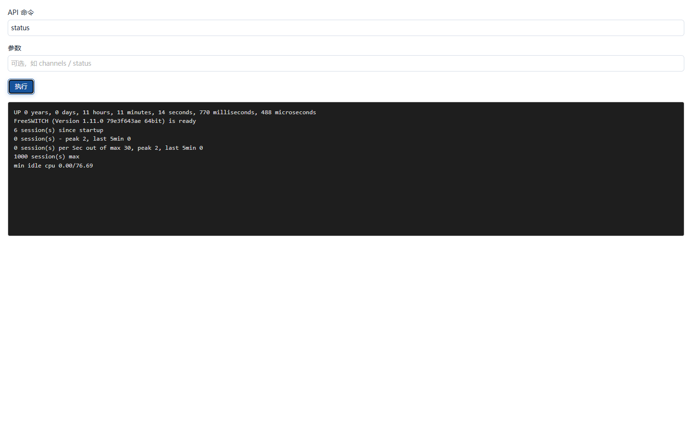

| 功能 | 用途 |
| --- | --- |
| 刷新通道 | 执行 `show channels`，可查看当前通话并强制挂断（uuid_kill） |
| Sofia状态 | 执行 `sofia status` |
| 注册列表 | `show registrations`，查看哪些分机在线 |
| 踢注册 | `sofia profile <p> flush_inbound_reg <user>`，强制某分机重注册 |
| 模块列表 | `show modules` |
| 模块操作 | `reload <moduleName>` 等 |
| ESL控制台 | 直接执行 ESL API（禁止 fsctl/shutdown/hupall 等危险命令） |
| reloadxml | 强制重新拉取全部 XML，常用于热生效失败后的补救 |
| 重启FS服务 | 执行 `shutdown restart` 重启 FS 进程。**仅用于**修改 event_socket、升级 FS、加载新模块、ESL 失联恢复；日常配置一律用热生效。重启期间所有通话中断、分机掉线，UDP/TCP/WS 分机自动重注册，浏览器软电话需手动点「连接」 |

### 7.3 通话记录（CDR）

CDR 由 `mod_cdr_pg_csv` 写入 `cdr` 表。关键字段：

| 字段 | 含义 |
| --- | --- |
| 主叫 `callerIdNumber` / 被叫 `destinationNumber` | 号码 |
| 开始/应答/结束时间 | `startStamp`/`answerStamp`/`endStamp` |
| `duration` / `billsec` | 总时长 / 计费时长（应答后秒数） |
| 挂机原因 `hangupCause` | `NORMAL_CLEARING`=正常挂断；其他值见 FS 挂机原因表 |
| `uuid` / `blegUuid` | 呼出双腿关联 |

列表按时间倒序展示 UUID、IP 地址、主叫/被叫、呼叫内容（context）、呼叫/应答/结束时间、时长、挂断原因与 bleg UUID；顶部「搜索」展开筛选条件，「导出」调用后端 Excel 导出接口：

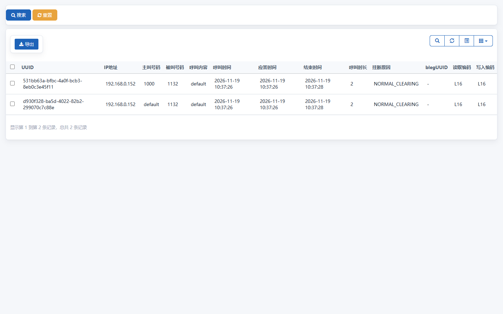

### 7.4 录音管理

浏览 `audioRecordPath`（系统参数）目录下的录音文件，可下载。录音是否产生取决于拨号计划里是否执行 `record_session`（本地分机 extension 模板已内置：设置 `record_path`/`record_name` 并用 `execute_on_answer` 录制）。

页面以文件浏览器形式展示：顶部输入「相对路径」可直接跳转，列表区分目录与文件（目录行「操作」为「进入」），文件行可下载：

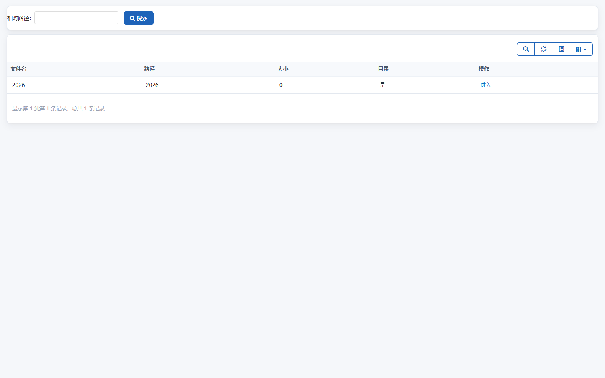

### 7.5 FS日志

按时间范围读取 `freeswitchLogPath` 指定的日志文件，深色终端风格展示。顶部选择「开始时间 / 结束时间」后点「查看日志」读历史文件，点「查看当前日志」直接看当前 `freeswitch.log`。未配置路径时页面会提示“未配置 freeswitchLogPath”。

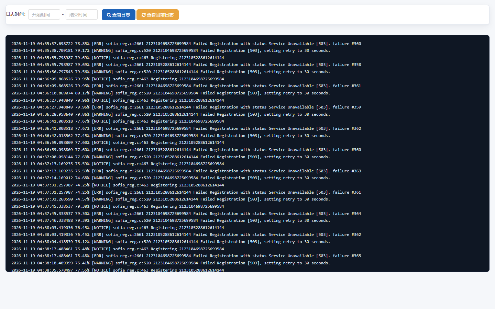

日志每行包含时间、级别（`NOTICE`/`WARNING`/`ERR`）与模块位置（如 `sofia_reg.c:2661`），排查注册与呼叫问题时按时间定位即可。

### 7.6 呼叫流程看板

入口：运行查看 → 呼叫流程看板（`/pbx/flow`）。

- 五列：入口 → ACL → 路由 → 拨号计划/动作 → 目的地。
- 输入被叫号码与主叫 IP，点「模拟匹配」：
  - ACL 按首条命中规则判断放行/拒绝；
  - 路由按编译后的正则匹配，命中项高亮，未命中淡化；
  - 给出下一跳结论（分机/IVR/队列/会议/留言/网关/挂断）。
- 点击节点右上角链接跳转到对应编辑页；顶部「热生效」执行 reloadxml。
- 看板数据直接复用 xml_curl 的取数与编译器，展示内容与 FS 实际收到的 XML 一致。

看板顶部是统计条（已启用路由 / 拨号方案 / IVR 流程 / 呼叫队列 / ACL 规则 / 可用分机），下方五列从左到右依次是呼叫入口、ACL 接入检查、路由匹配、拨号计划/动作、目的地/终端：

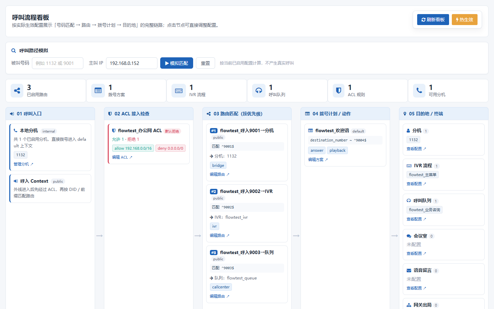

在「呼叫路径模拟」里输入被叫号码与主叫 IP 后点「模拟匹配」，结果区给出结论：ACL 放行/拒绝及命中的 CIDR、命中的路由与下一跳。下图 `9002` + `192.168.0.152` 命中 `flowtest_呼入9002—IVR`，命中节点高亮、未命中路由淡化：

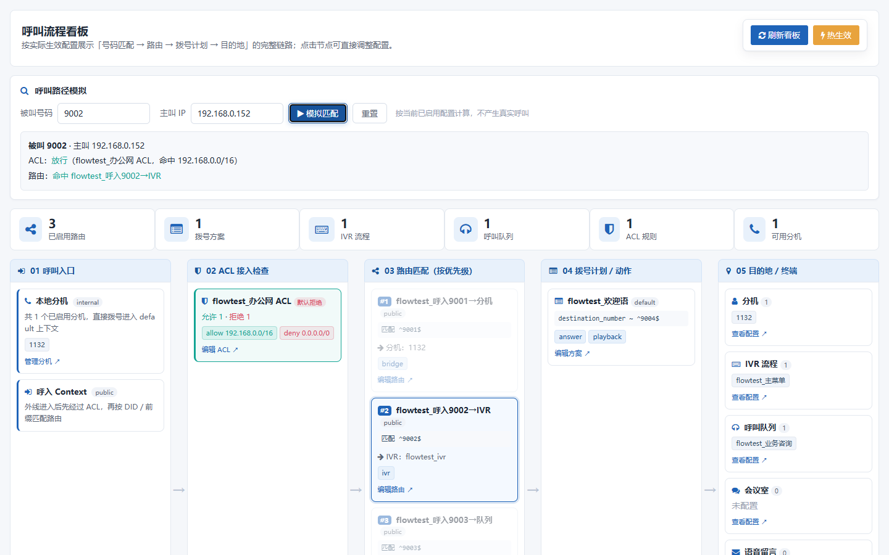

### 7.7 悬浮软电话

顶栏「软电话」按钮打开悬浮面板，可拖到任意位置，不影响下方系统操作。面板顶部有「呼叫」和「设置」两个独立页签，两者不会同时展开：呼叫页只放拨号盘与通话控制，设置页只放 SIP 参数与连接按钮，可随时来回切换。

点顶栏「软电话」后，挂件默认出现在左下角，标题栏可拖动，右上角为最小化与关闭：

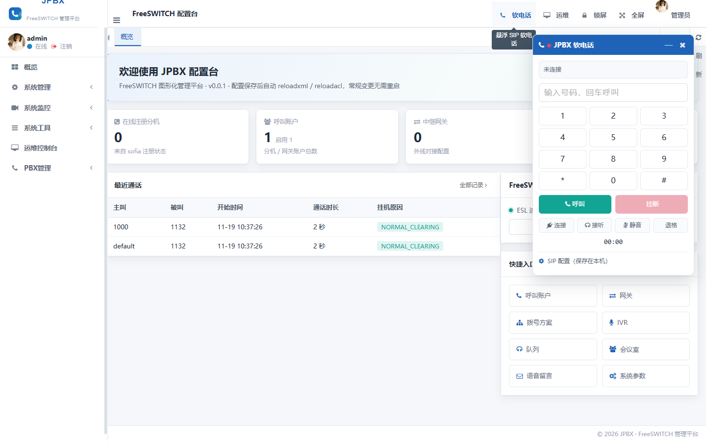

「呼叫」页自上而下为连接状态、号码输入框（回车即呼叫）、数字拨号盘、呼叫/挂断/接听/静音按钮与通话计时：

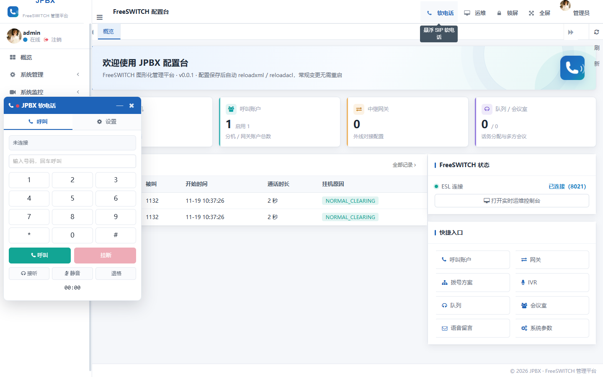

「设置」页只有 5 个输入项（WebSocket 地址、SIP 账号、密码、显示名、连接时自动注册）和 3 个按钮（保存并重新连接 / 仅连接 / 返回呼叫页），配置仅保存在本机浏览器：

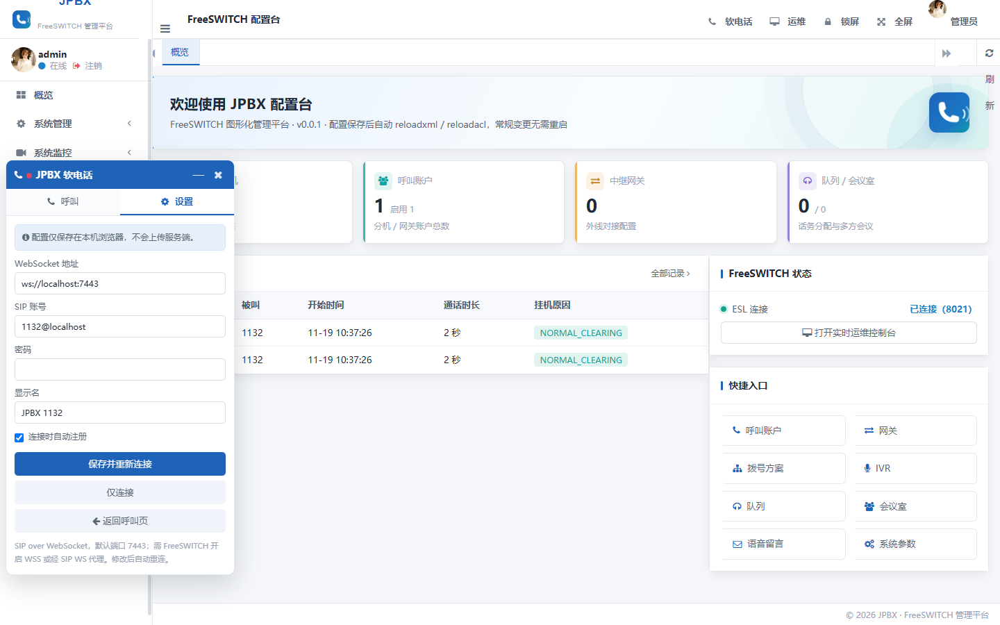

设置页字段含义：

| 配置项 | 含义 |
| --- | --- |
| WebSocket 地址 | 默认 `ws://<FS主机IP>:5066`（FS 的 `ws-binding`，明文，无需证书，内网推荐）；`wss://<FS主机IP>:7443`（`wss-binding`，自签证书需先在浏览器打开 `https://<FS主机IP>:7443` 信任一次） |
| SIP 账号 | `号码@域`，如 `1133@192.168.0.152` |
| 密码 | 与分机管理中的密码一致 |
| 显示名 | 来电显示名称 |
| 自动注册 | 连接时是否注册 |

配置保存在浏览器 `localStorage`（键 `jpbx.sip.config.v1`），不上传服务端；「保存并重新连接」写入本地配置并立即重连，支持拨号盘、呼叫、接听、挂断、静音、通话计时。

挂件可拖到页面任意位置，位置不影响下方页面滚动与点击：

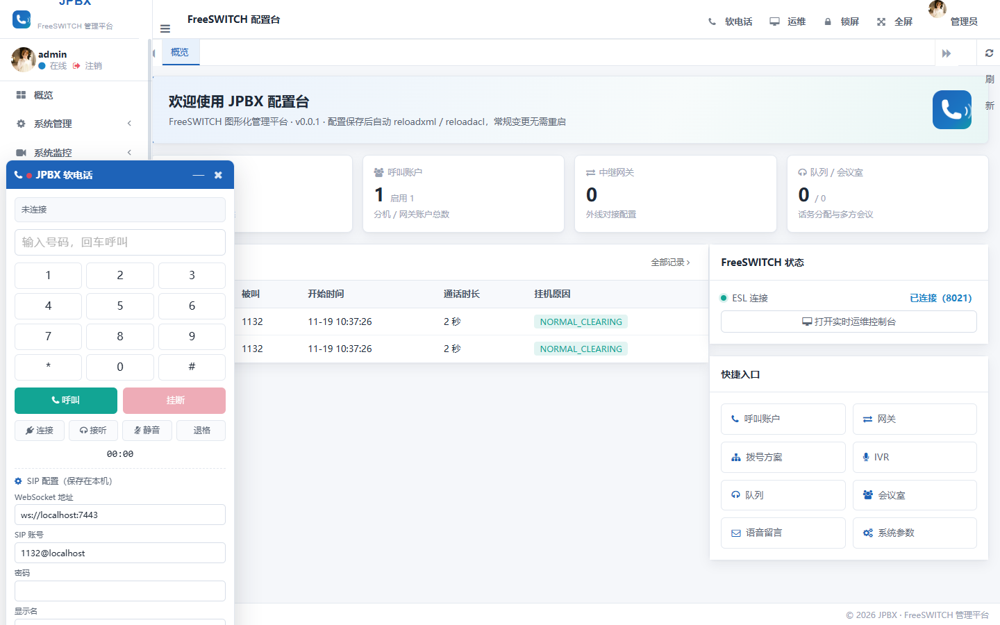

挂件悬浮期间，下方页签（如通话记录、分机管理）仍可正常切换和操作：

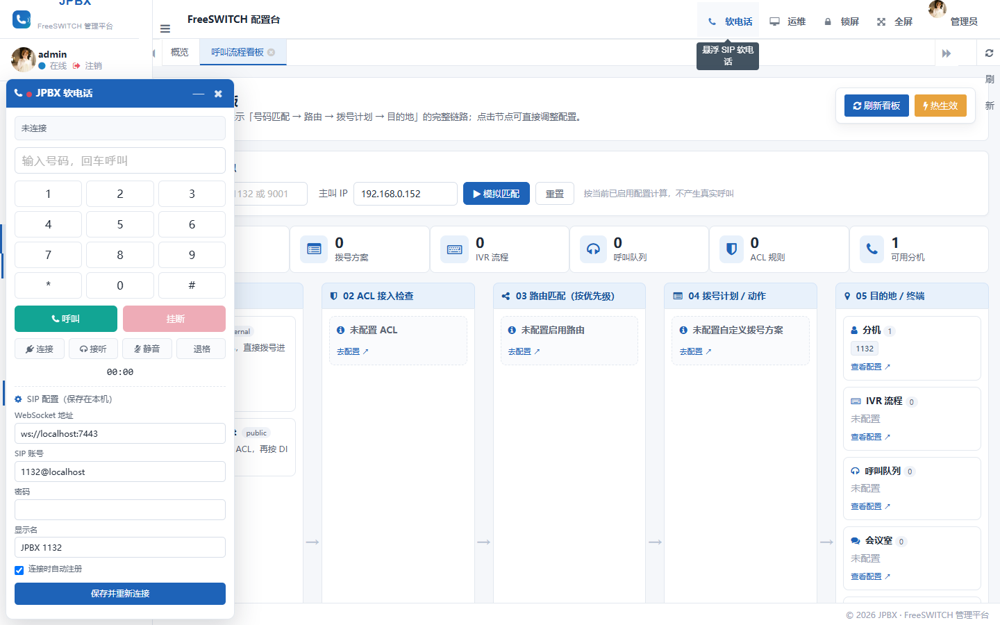

> 要求 FS 侧提供 WS/WSS 的 SIP-over-WebSocket 接入（见 6.2 的 `ws-binding`/`wss-binding`），仅启用 `mod_verto` 的 Verto JSON 协议不兼容。浏览器需 `localhost` 或 HTTPS 才能使用麦克风；用 `http://<IP>:8090` 打开时麦克风被禁，可在 `chrome://flags/#unsafely-treat-insecure-origin-as-secure` 加入 `http://<IP>:8090` 白名单临时解决。
>
> 软电话接通后若听不到对方，日志会给出诊断（`远端音频：播放正常推进 / 未取到媒体流 / 自动播放被拦截 / 流已绑定但播放未推进`），拨号盘「试听」按钮可验证本机扬声器。

---

## 8. 典型配置案例

### 案例 1：分机 1001 与 1002 互拨

1. 分机管理新增 `1132`、`1133`，域填 `192.168.0.152`，类型选「分机」，设置密码（真实环境：1132 密码 `1234` 用于手机 Linphone/UDP，1133 密码 `1111` 用于浏览器软电话/WS）。
2. 确认 SIP 域名中该域已启用。
3. 两个客户端分别注册：手机 Linphone 填 用户名 `1132`、域名 `192.168.0.152`、密码 `1234`、传输 UDP、代理留空；浏览器软电话填 `ws://192.168.0.152:5066` + `1133@192.168.0.152` + `1111`。
4. 软电话拨 `1132` → 走 `default` 上下文的 `local_extension`，bridge 到 `user/1132@${domain_name}`，手机振铃。
5. 验证：`show registrations`、`show channels`，挂机后 CDR 出现记录。

### 案例 2：外线呼入 DID 9001 → IVR → 队列

1. IVR菜单新建 `main_ivr`，并通过 DB/API 配置按键 `1 → extension 1001`、`2 → queue sales`。
2. 呼叫队列新建 `sales`，策略 `longest-idle-agent`。
3. 坐席管理新建 `agent1001`，contact `user/1001`，状态 `Available`。
4. Tier 绑定 `agent1001` 到 `sales`，level=1（无页面，用 `POST /pbx/tier/add`，见 5.4）。
5. 路由管理新增：
   - 类型：呼入（2），DID：`9001`，context 自动为 `public`；
   - 目的地类型：IVR，目的地：`main_ivr`；排序 10。
6. 保存后检查 xml_curl：

```bash
curl -X POST http://localhost:8090/pbx/api/xml \
  -d "token=jpbx-xml-curl-token&section=dialplan&Caller-Context=public"
```

7. 从外线拨 9001，应听到 IVR 提示；按 2 进入队列。

### 案例 3：内部分机拨 9 开头号码走网关出局

1. 中继网关新建 `gw_carrier`：realm 为运营商地址，类型选「注册中继」或「对等中继」，填账号密码（注册时）。
2. 路由管理新增：
   - 类型：呼出（1），匹配前缀：`^9(\d+)$`，context=default；
   - 新增被叫前缀留空、被叫前缀删除位数填 `1`（删掉引导 9）；
   - 目的地类型：中继（外呼），目的地：`gw_carrier`；排序 10。
3. 分机拨 `913800123456` → 编译后 `outbound_number=${destination_number:1}` → bridge `sofia/gateway/gw_carrier/13800123456`。
4. 验证 `sofia status gateway gw_carrier` 与 CDR。

### 案例 4：只允许办公网注册，其他 IP 拒绝

1. ACL 新建 `trusted`，默认策略 `deny`，网段：

```
allow 192.168.0.0/16
allow 127.0.0.1/32
deny  0.0.0.0/0
```

2. FS参数配置 → sofia.conf/internal → `apply-inbound-acl` 改为 `trusted`，保存（会 restart internal profile）。
3. 办公网客户端可注册；外部 IP 注册被拒。
4. 在呼叫流程看板输入主叫 IP `192.168.0.152` 应显示「放行（命中 192.168.0.0/16）」。

### 案例 5：呼叫进入会议室 3000 并设置 PIN

1. 会议室新建 `3000`，Profile=`default`，PIN=`1234`。
2. 分机拨 `3000` → 走 `conf_3000` extension，模板要求输入 PIN 后入会。
3. 或路由目的地类型选「会议室」，值 `3000`，由路由统一引导。

---

## 9. 故障排查速查

| 现象 | 可能原因 | 处理 |
| --- | --- | --- |
| 分机注册失败 | 域不一致 / 密码错 / `accept-blind-reg=true` / ACL 拒绝 | 检查分机 domain、密码；FS参数确认 `accept-blind-reg=false`；检查 ACL 与 `apply-inbound-acl` |
| 改了分机密码但还能用旧密码注册 | 未执行 reloadxml 或客户端未重注册 | 点保存后确认热生效成功；客户端重新注册 |
| 呼叫无路由 | 路由 `enabled=0`、context 不匹配、正则写错、目的地为空 | 用呼叫流程看板模拟号码；检查 xml_curl 的 dialplan 返回 |
| 所有呼叫都进不去 | xml_curl token/IP 白名单错误、FS 未 reloadxml | 检查 `fs.properties` 的 token/allowedIps；ESL 执行 reloadxml |
| CDR 没数据 | `cdrDbInfo` 未配置或密码错、FS 未 reload mod_cdr_pg_csv | 检查系统参数；FS 执行 `reload mod_cdr_pg_csv`；查看 `log/cdr-pg-csv/cdr-spool.csv` |
| 队列无坐席接听 | 坐席 `status=Logged Out`、contact 错误、Tier 未绑定、level 过大 | 检查坐席状态/contact、Tier 记录；`callcenter_config agent list` |
| IVR 按键无反应 | entries 未配置、action/param 不合法、digitLen 不匹配 | 检查 `t_pbx_ivr_entry`；看板查看按键分支 |
| 网关注册不上 | realm/账号密码错、transport 不匹配、端口冲突 | `sofia status gateway <id>`；检查 transport 与 external sip-port |
| 热生效失败 | ESL 未连接、FS 未启动 | 首页 ESL 状态灯；「实时运维 → reloadxml」重试 |
| 软电话连接失败 | WSS 未开启、地址/端口错误、非 HTTPS 环境无麦克风权限 | 检查 `wss-binding=:7443`；用 localhost/HTTPS；面板查看日志 |
| 系统参数保存后大量分机掉线 | 该操作会 restart sofia profile | 属预期行为，等待客户端自动重注册或手动重注册 |
| **浏览器与手机互通，双方都听不到声音** | **opus 声道错配直通转发**（浏览器 opus stereo=2、手机 opus mono=1，FS 判定同名 codec 直通，payload/声道不匹配，两端全丢包） | FS 参数确认 `inbound/outbound-codec-prefs` 为 `PCMU,PCMA,OPUS` 且 `inbound-codec-negotiation=greedy`，保存重启 profile。验证：FS 日志应出现 `Set Codec ... PCMU/8000`，且 `Opus decoder stats` 不再是唯一转码记录 |
| **改了编解码偏好但没生效** | `inbound-codec-negotiation=generous`（按对端 offer 顺序选，手机端 opus 排第一绕过 PCMU 优先） | 改 `greedy` 后重启 profile |
| 软电话连接后 2~5 秒失败，FS 日志无任何记录 | 软电话配置没写入 UA，实际连到了 sip.js 内置默认地址 `wss://edge.sip.onsip.com`（返回 OpenSIPS 403） | 检查脚本版本；设置页 WebSocket 地址填 `ws://<FS主机IP>:5066` 保存重连；抓包确认 REGISTER 目标 |
| 点呼叫立即失败「未知原因」，FS 日志无 INVITE | `http://<IP>:8090` 非安全上下文，Chrome 禁用 getUserMedia，INVITE 发不出去 | `chrome://flags` 加白名单 / 用 `localhost` / 配 HTTPS；呼叫日志会明确提示麦克风原因 |
| 局域网通话延迟明显 | FS 侧无 jitterbuffer，延迟多来自手机端：VPN 隧道绕路、Linphone 自适应抖动缓冲/回声消除 | 断开手机 VPN 对比测试；Linphone 设置关「自适应抖动缓冲/回声消除」试听；如需去掉 FS 转码开销，出向编解码去掉 OPUS（全链路 PCMU） |

---

## 附录 A：配置核对清单（上线前）

- [ ] 所有分机的 `domain` 与实际注册域一致，密码已下发。
- [ ] SIP 域名已启用，`parse`/`alias` 符合多域需求。
- [ ] 路由按优先级排序，目的地明确，未使用「未配置（旧规则）」兜底。
- [ ] ACL 默认策略为 `deny`，且 `apply-inbound-acl` 已指向正确 list。
- [ ] `cdrDbInfo` 连接串正确，CDR 表可写。
- [ ] 系统参数中的 `audioRecordPath`、`freeswitchLogPath` 存在且 FS 可写。
- [ ] 修改系统参数已通知用户重新注册分机。
- [ ] 呼叫流程看板模拟主叫/被叫，路径符合设计。

## 附录 B：常用命令

```bash
# xml_curl 冒烟（真实环境：域 192.168.0.152）
curl -X POST http://localhost:8090/pbx/api/xml \
  -d "token=jpbx-xml-curl-token&section=dialplan&Caller-Context=default"
curl -X POST http://localhost:8090/pbx/api/xml \
  -d "token=jpbx-xml-curl-token&section=configuration&key_value=sofia.conf"
# 确认编解码配置：inbound/outbound-codec-prefs=PCMU,PCMA,OPUS，inbound-codec-negotiation=greedy

# FS 侧
fs_cli -x "status"
fs_cli -x "reloadxml"
fs_cli -x "show registrations"
fs_cli -x "show channels"
fs_cli -x "sofia status profile internal reg"
fs_cli -x "sofia status gateway <网关ID>"
fs_cli -x "callcenter_config queue list"
fs_cli -x "callcenter_config agent list"
fs_cli -x "sofia global siptrace on"   # 排查信令时开启，查完关闭

# 数据库侧
psql -U postgres -d youpbx -c "select number,domain,enabled from t_pbx_user;"
psql -U postgres -d youpbx -c "select caller_id_number,destination_number,billsec,hangup_cause from cdr order by start_stamp desc limit 10;"
```

## 附录 C：界面截图索引

全部截图存于 `doc/images/pbx-test/`，按「章节图号」编排，便于按图索骥或替换为现场环境截图。

| 图号 | 内容 | 文件 | 正文位置 |
| --- | --- | --- | --- |
| 图 2-1 | 登录页 | `01_login.png` | 2.1 |
| 图 2-2 | 主界面与首页概览 | `02_index.png` | 2.1 |
| 图 2-3 | PBX 管理菜单分组（5 组） | `26_menu_groups.png` | 2.2 |
| 图 2-4 | 「运行查看」分组展开 | `27_menu_group_expanded.png` | 2.2 |
| 图 2-5 | 打开「通话记录」页签 | `28_menu_group_open.png` | 2.2 |
| 图 2-6 | 侧边栏层级导航与选中态 | `35_sidebar_hierarchy.png` | 2.2 |
| 图 2-7 | 当前叶子菜单高亮 | `37_menu_active_leaf.png` | 2.2 |
| 图 3-1 | 呼叫账户列表 | `04_user_list.png` | 3.1 |
| 图 3-2 | 新增呼叫账户弹窗 | `05_user_modal.png` | 3.1 |
| 图 3-3 | 新增呼叫账户表单明细 | `05_user_add.png` | 3.1 |
| 图 3-4 | SIP 域名列表 | `06_domain_list.png` | 3.2 |
| 图 3-5 | 分机组列表 | `07_group_list.png` | 3.3 |
| 图 3-6 | 语音留言记录列表 | `16_voicemail_list.png` | 3.4 |
| 图 4-1 | 中继网关列表 | `08_gateway_list.png` | 4.1 |
| 图 4-2 | 路由管理列表 | `10_route_list.png` | 4.2 |
| 图 4-3 | 拨号方案列表 | `09_dialplan_list.png` | 4.3 |
| 图 4-4 | ACL 列表 | `17_acl_list.png` | 4.4 |
| 图 5-1 | IVR 菜单列表 | `11_ivr_list.png` | 5.1 |
| 图 5-2 | 呼叫队列列表 | `12_queue_list.png` | 5.2 |
| 图 5-3 | 坐席管理列表 | `13_agent_list.png` | 5.3 |
| 图 5-4 | 会议室列表 | `15_conference_list.png` | 5.5 |
| 图 6-1 | 系统参数列表 | `18_sysconf.png` | 6.1 |
| 图 6-2 | FS 参数配置（switch.conf） | `19_fsconf.png` | 6.2 |
| 图 6-3 | 系统用户管理 | `25_system_user.png` | 6.3 |
| 图 7-1 | 首页整体布局 | `36_home_enriched.png` | 7.1 |
| 图 7-2 | 概览卡片、最近通话与快捷入口 | `03_overview.png` | 7.1 |
| 图 7-3 | 实时运维（通道列表） | `20_ops.png` | 7.2 |
| 图 7-4 | ESL 控制台执行命令 | `21_ops_console.png` | 7.2 |
| 图 7-5 | 通话记录（CDR）列表 | `22_call_list.png` | 7.3 |
| 图 7-6 | 录音管理（文件浏览） | `23_record_list.png` | 7.4 |
| 图 7-7 | FS 日志（终端风格） | `24_log_list.png` | 7.5 |
| 图 7-8 | 呼叫流程看板（五列全景） | `29_callflow_board.png` | 7.6 |
| 图 7-9 | 号码 9002 路径模拟结果 | `30_callflow_simulate.png` | 7.6 |
| 图 7-10 | 顶栏打开悬浮软电话 | `31_sip_widget.png` | 7.7 |
| 图 7-11 | 软电话「呼叫」页 | `38_sip_tabs_call.png` | 7.7 |
| 图 7-12 | 软电话「设置」页 | `39_sip_tabs_settings.png` | 7.7 |
| 图 7-13 | 软电话拖动到任意位置 | `33_sip_dragged.png` | 7.7 |
| 图 7-14 | 软电话悬浮时下方页签正常操作 | `34_sip_with_tab.png` | 7.7 |

说明：

- 「Tier 分机绑定」（5.4）当前版本无页面入口，只能通过接口或数据表维护，故无截图；原计划的文件编号 `14` 空置未使用。
- `32_sip_config.png` 为软电话改造前的旧设置面板，已被图 7-12（`39_sip_tabs_settings.png`）取代，未再引用。
- 「重启FS服务」按钮（7.2/1.4）为本次新增功能，暂无截图；页面位置在实时运维工具栏最右侧（红色「重启FS服务」）。
- 复现截图的条件：服务以 `start-jpbx.bat start` 启动、登录账号 `admin`、演示数据（分机 1132、路由 `flowtest_*`、IVR `flowtest_ivr`、队列 `flowtest_queue`）已导入。
